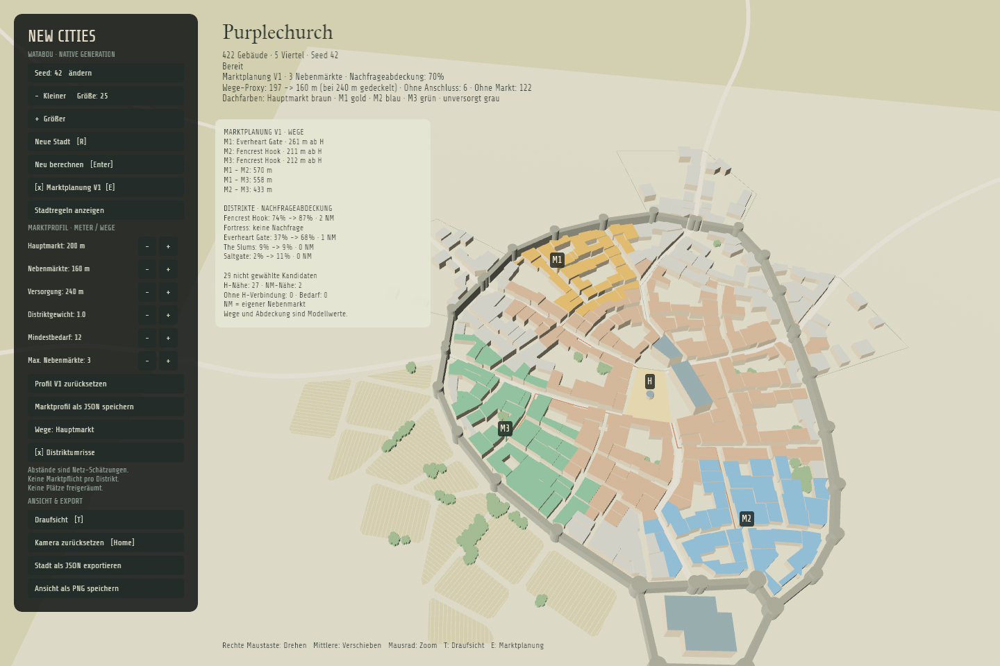

# New Cities · Rust / Bevy 0.20.0

Nativer Rust-Port des rekonstruierten Watabou-Stadtgenerators, mit einer Bevy-Anwendung für die Darstellung der Grundrisse in 3D. Die Bevy-Version ist auf **0.20.0** festgelegt, die Rust-Toolchain auf **1.97.1**.

```sh
cargo run
```

Der erste Build kompiliert Bevy und dauert entsprechend länger. Der Generator läuft anschließend vollständig im Rust-Prozess; Node, JavaScript-Engine, Browser und Netzwerk werden zum Generieren nicht benötigt.


## Archiv

Der rekonstruierte, ausführbare TypeScript-Stand liegt unter [backlog/typescript-2026-10-14](backlog/typescript-2026-10-14/README.md), einschließlich Quellcode, Tests und Assets. Rust- und TypeScript-Quellen wurden aus `Archiv.zip` gerettet; generierte Quellen, Referenzdaten und Lockfiles wurden neu erzeugt. Das Originalbundle und die fünf Namensassets stimmen mit den im Chat dokumentierten Prüfsummen überein.

Die [Archivdateiliste](backlog/typescript-2026-10-14.manifest.json) prüft den **wiederhergestellten** Stand, nicht den verlorenen ursprünglichen Ordner. Fehlende historische Browserreferenzen, Analyse-Caches und Git-Historie sind im [Wiederherstellungsbericht](docs/recovery.md) abgegrenzt.

Die archivierte Webversion bleibt ausführbar:

```sh
cd backlog/typescript-2026-10-14
npm ci
npm run dev
```

## Bedienung

Die Seitenleiste steuert Seed, Stadtgröße, Zitadelle, innere Burg, Marktplatz, Tempel, Mauern, Vorstadt, Küste, Fluss, Grünflächen, Hub und Tore. Ein Klick auf den Seed erlaubt die Eingabe einer Zahl. Geänderte Merkmale berechnen die Stadt neu.

| Eingabe | Aktion |
| --- | --- |
| Rechte Maustaste ziehen | Kamera drehen |
| Mittlere Maustaste ziehen | Kamera verschieben |
| Mausrad | Zoom |
| `R` | Neue Stadt mit nächstem Seed |
| `Enter` | Stadt erneut berechnen / Seed übernehmen |
| `T` | Zwischen Draufsicht und Perspektive wechseln |
| `E` | Marktplanung V1 ein-/ausschalten |
| `B` | Gebäudeformen V1 ein-/ausschalten |
| `Home` | Kamera zurücksetzen |
| `+` / `−` | Stadtgröße ändern |
| `Esc` | Seedeingabe abbrechen / Anwendung schließen |

JSON- und PNG-Exporte werden unter `exports/` gespeichert. PNG enthält die aktuelle Bevy-Ansicht. Ohne Gebäudeplanung enthält JSON die ursprünglichen Grundrisse (Version 1). Mit Gebäudeplanung enthält Version 2 die angezeigten Grundrisse in `city`, den Originalbestand in `originalCity` und die Entscheidungen in `buildingPlanning`. Straßen-, Mauer-, Gewässer- und Baumgeometrie bleiben unverändert.

```sh
cargo run -- --seed 42 --size 10 --river
cargo run -- --export exports/city.json
cargo run -- --snapshot exports/reference.json
cargo run -- --options village.json
```

`--export` und `--snapshot` erzeugen kein Fenster. `village.json` enthält die Felder von `CityOptions`; fehlende Felder erhalten die Standardwerte, beispielsweise:

```json
{"seed":42,"size":5,"citadel":false,"walls":false,"temple":false,"greens":true}
```

## Marktplanung V1

Die akzeptierte Marktlogik aus dem HTML-Stadtlabor ist als zuschaltbares Rust-Feature übernommen: getrennte Laufwegabstände zum Hauptmarkt und zwischen Nebenmärkten, Bedarf und Distriktgewicht **ohne Marktpflicht pro Distrikt**. Grundrisse und Original-Zufallszustand bleiben unverändert; es werden noch keine Plätze freigeräumt, Höfe gebaut oder Wachstumsschritte simuliert.

```sh
cargo run -- --seed 42 --size 25 --economy
cargo run -- --market-profile assets/market-profiles/market-v1.json
cargo run -- --write-market-profile exports/market-profile.json
cargo run -- --market-profile exports/market-profile.json --export exports/city.json
```

Mit `E` ein-/ausschalten; „Marktregeln anzeigen“ öffnet die Plus/Minus-Regler, Profil-Reset, Profil-Speicherung und Wege-/Distriktanzeige. Dachfarben zeigen Markteinzug, **keine Gebäudenutzung**: H braun, M1 gold, M2 blau, M3 grün, M4 violett, M5 rot; unversorgte Gebäude grau. Beschriftete Pins markieren Kandidaten. Laufwege und Distriktabdeckung stehen im Bericht und JSON-Export.

Das benannte V1-Profil ist konfigurierbar. Das HTML-Stadtlabor bleibt als Referenz erhalten; Rust wird gegen alle 27 gespeicherten Konfigurationen geprüft. Künftige Features können über `plan_markets(&city, &profile, &demand_overrides)` explizite Nachfragegewichte liefern, statt Markteffekte unkontrolliert zurückzukoppeln.

**Grenzen:** Das Wegenetz und Gebäudezugänge sind Annäherungen, keine zertifizierten Fußgängerrouten. Abdeckung verwendet zunächst Gebäudegrundfläche, nicht Einwohnerzahlen. Der Wegemittelwert ist beim jeweiligen Versorgungsweg gedeckelt. Grundstücke, Platzflächen, Kapazität, Abriss und wirtschaftliche Entwicklung sind noch nicht modelliert.



Details, Profilformat und Nachfrage-Interface: [Marktplanung V1](docs/market-planning-v1.md). Quellen: [Recherche](docs/research-organic-cities.md). Die [Experimentierspur](docs/organic-city-experiments.md) hält die früheren Marktflächen-/Hof-/Vorstadtversuche und offenen Fragen fest; die HTML-Stadtlabore liegen unter `crates/city_core/prototypes/`.

## Gebäudeformen V1

Mit `B` oder `--buildings` zuschalten: zu kleine oder unbrauchbar schmale/spitze Restformen werden ausgelassen oder mit direkten Nachbarn vereinigt. Schmale Streifen werden entlang gemeinsamer Längswände aufgeteilt, statt am kurzen Ende als dünner Arm angehängt zu werden. Flächenverlust und Zuordnungen sind nachvollziehbar; der Originalmodus bleibt unverändert verfügbar.

```sh
cargo run -- --options assets/city-options/stormwind.json --buildings
cargo run -- --building-profile assets/building-profiles/buildings-v1.json
cargo run -- --write-building-profile exports/building-profile.json
cargo run -- --options assets/city-options/stormwind.json --buildings --export exports/planned-city.json
```

Die Marktplanung wird bei gemeinsamer Aktivierung auf den tatsächlich angezeigten Grundrissen neu berechnet. Die Formgrenzen sind konfigurierbare Versuchswerte, keine zertifizierten Raummaße. Komplexe lokale Engstellen, tatsächliche Nutzung und Eigentumsrechte bleiben offen. Details, Exportversion und Prüfnachweise: [Gebäudeformen V1](docs/building-planning-v1.md).

## Generator verwenden

```rust
use city_core::{CityOptions, generate_city};

let city = generate_city(&CityOptions {
    size: 5,
    seed: 42,
    citadel: false,
    ..Default::default()
})?;
// city.wards[].buildings[].polygon: ursprüngliche Gebäudegrundrisse
// city.original_geometry: Straßen, Mauern, Gewässer, Baumkronen usw.
# Ok::<(), city_core::GenerationError>(())
```

`city_core` hängt nicht von Bevy ab. Intern bleiben Objektidentitäten und veränderliche Referenzen des ursprünglichen Haxe-Modells durch eine Arena erhalten. Die 790 übertragenen Funktionen werden als Rust kompiliert; die dynamische Kompatibilitätsschicht ist keine JavaScript-Engine. Das öffentliche Modell verwendet normale Rust-Strukturen und `f64`.

Die Darstellung ordnet ursprüngliches X/Y den Bevy-Achsen X/Z zu. Eine ursprüngliche Karteneinheit entspricht vier Metern. Gebäudehöhen und flache Dächer sind eine zusätzliche Darstellung der ursprünglichen 2D-Grundrisse. Terrain bleibt zunächst eben; `HeightField` und `FlatTerrain` bilden die Schnittstelle für den nächsten Schritt. Hangabhängige Straßenplanung, Terrassierung und Geländeänderungen sind noch nicht implementiert.

## Prüfen und Herkunft

```sh
cargo test --workspace
cargo fmt --all --check
cargo clippy --workspace --all-targets -- -D warnings
python3 tools/verify-archive.py
node tools/verify-building-draft.mjs
```

Die Referenzen stammen aus dem unabhängig ausgeführten vollständigen Originalbundle, Version **0.11.5, Build 2431**. Verglichen werden vollständige kanonische Modelle mit exakten `f64`-Werten, ohne Rundungstoleranz. Die Referenzumgebung ist Node 26.7.0 auf macOS ARM64. Verschiedene JavaScript-Laufzeiten lieferten bereits im Original unterschiedliche Ergebnisse einzelner Math-Funktionen; deshalb bedeutet dieser Vergleich keine pauschale Bitgleichheit mit jeder Browser-/CPU-Kombination.

`generate_blueprint_city(&options, random_features)` stellt zusätzlich die ursprüngliche New/Rebuild-Generierung einschließlich zufälliger Merkmale und aufgelöster Küstenrichtung bereit. Ihre zurückgegebenen Optionen lassen sich durch `generate_city` wiedergeben.

Die Bevy-Oberfläche konzentriert sich auf Generierung, Kamera und Export. Die sechs Web-Farbpaletten, Warp/Undo, SVG-Export und interaktives Umbenennen bleiben in der archivierten Webversion erhalten. Die zugrunde liegenden ursprünglichen Namensgeneratoren sind im Rust-Kern enthalten.

Details: [Port und Verifikation](docs/rust-port.md). Originalalgorithmus und Gestaltung: **Oleg Dolya / Watabou**. Die Trigonometrie übernimmt V8/fdlibm-Ausdrücke; Hinweise stehen in [math.rs](crates/city_core/src/math.rs), die V8-Lizenz unter [assets/licenses](assets/licenses/V8-LICENSE).
