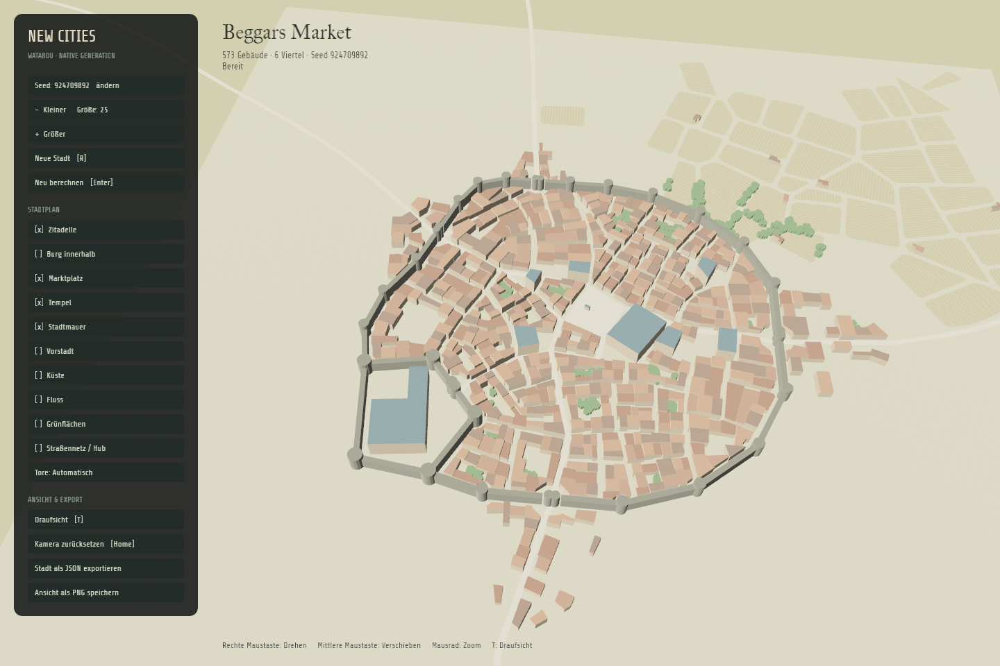
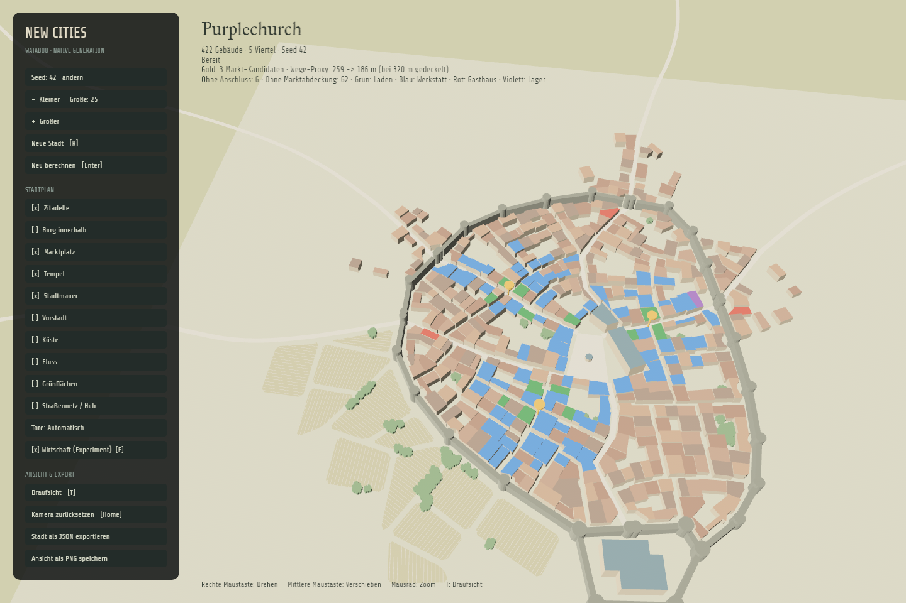

# New Cities · Rust / Bevy 0.20.0

Nativer Rust-Port des rekonstruierten Watabou-Stadtgenerators, mit einer Bevy-Anwendung für die Darstellung der Grundrisse in 3D. Die Bevy-Version ist auf **0.20.0** festgelegt, die Rust-Toolchain auf **1.97.1**.

```sh
cargo run
```

Der erste Build kompiliert Bevy und dauert entsprechend länger. Der Generator läuft anschließend vollständig im Rust-Prozess; Node, JavaScript-Engine, Browser und Netzwerk werden zum Generieren nicht benötigt.



## Archiv

Der rekonstruierte, ausführbare TypeScript-Stand liegt unter [backlog/typescript-2026-10-14](backlog/typescript-2026-10-14/README.md), einschließlich Quellcode, Tests und Assets. Rust- und TypeScript-Quellen wurden aus `Archiv.zip` gerettet; generierte Quellen, Referenzdaten und Lockfiles wurden neu erzeugt. Das Originalbundle und die fünf Namensassets stimmen mit den im Chat dokumentierten Prüfsummen überein.

Die [Archivdateiliste](backlog/typescript-2026-10-14.manifest.json) prüft den **wiederhergestellten** Stand, nicht den verlorenen ursprünglichen Ordner. Fehlende historische Browserreferenzen, Analyse-Caches und Git-Historie sind im [Wiederherstellungsbericht](docs/recovery.md) abgegrenzt.

Die archivierte Webversion bleibt ausführbar:

```sh
cd backlog/typescript-2026-10-14
npm ci
npm run dev
```

## Bedienung

Die Seitenleiste steuert Seed, Stadtgröße, Zitadelle, innere Burg, Marktplatz, Tempel, Mauern, Vorstadt, Küste, Fluss, Grünflächen, Hub und Tore. Ein Klick auf den Seed erlaubt die Eingabe einer Zahl. Geänderte Merkmale berechnen die Stadt neu.

| Eingabe | Aktion |
| --- | --- |
| Rechte Maustaste ziehen | Kamera drehen |
| Mittlere Maustaste ziehen | Kamera verschieben |
| Mausrad | Zoom |
| `R` | Neue Stadt mit nächstem Seed |
| `Enter` | Stadt erneut berechnen / Seed übernehmen |
| `T` | Zwischen Draufsicht und Perspektive wechseln |
| `E` | Wirtschaftsanalyse ein-/ausschalten (Experiment) |
| `Home` | Kamera zurücksetzen |
| `+` / `−` | Stadtgröße ändern |
| `Esc` | Seedeingabe abbrechen / Anwendung schließen |

JSON- und PNG-Exporte werden unter `exports/` gespeichert. PNG enthält die aktuelle Bevy-Ansicht; JSON enthält die unveränderten zweidimensionalen Grundrisse und die ursprüngliche Straßen-, Mauer-, Gewässer- und Baumgeometrie.

```sh
cargo run -- --seed 42 --size 10 --river
cargo run -- --export exports/city.json
cargo run -- --snapshot exports/reference.json
cargo run -- --options village.json
```

`--export` und `--snapshot` erzeugen kein Fenster. `village.json` enthält die Felder von `CityOptions`; fehlende Felder erhalten die Standardwerte, beispielsweise:

```json
{"seed":42,"size":5,"citadel":false,"walls":false,"temple":false,"greens":true}
```

## Experiment: wirtschaftlich plausible Stadt

Die Leitlinie ist historisch inspiriert, aber nicht historisch gebunden: Nutzungen sollen nachvollziehbare Standortgründe haben. Die erste zuschaltbare Analyse schlägt bis zu drei kleine Nebenmarkt-Standorte vor und kennzeichnet gewöhnliche Gebäude als Wohnen, Wohnen mit Laden/Werkstatt, Gasthaus oder Lager. **Sie verändert keine Grundrisse, schafft noch keine freien Marktflächen und simuliert noch keine Bauphasen.** Sonderbauten bleiben unverändert.

```sh
cargo run -- --seed 42 --size 25 --economy
cargo run -- --seed 42 --size 25 --economy --export exports/economy.json
```

In der Anwendung schaltet der Knopf „Wirtschaft (Experiment)“ oder `E` die Analyse um. Goldene Pins markieren Markt-Kandidaten, Dachfarben mögliche Nutzungen: Grün = Laden, Blau = Werkstatt, Rot = Gasthaus, Violett = Lager; gewöhnliches Wohnen behält seine Dachfarbe. Marktzuordnungen und die versorgte Gebäudegrundfläche stehen im JSON-Export. Mit aktivierter Analyse ergänzt der Export das Feld `economy` neben dem unveränderten `city`; ohne Analyse bleibt das bisherige Format erhalten. `--snapshot` bleibt ausschließlich der Originalvergleich und kann nicht mit `--economy` kombiniert werden.

Die Analyse verwendet Gebäudegrundfläche als Nachfrage-Proxy, keine geschätzte historische Bevölkerung. Ein rekonstruiertes Straßennetz verbindet echte Schnittpunkte und ergänzt höchstens zwei Karteneinheiten lange Anschlüsse an eingerückten Gassenenden. Vorschläge an Kreuzungen reduzieren die grundflächengewichtete Entfernung zu Märkten; zwischen Standorten bleiben mindestens 25 Netz-Karteneinheiten. Vorhandene anschließbare Märkte zählen mit; alle Netzpunkte auf oder innerhalb ihrer Marktfläche dienen als Zugänge mit geprüften Barrieren und Zugangskosten. Gasthäuser und Lager bevorzugen Tornähe, Laden-/Werkstattnutzungen Marktnähe; ein stabiler, vom Original-RNG unabhängiger Wert variiert die Zuordnung.

**Grenzen:** Das Netz ist eine Annäherung, kein garantierter Fußgängerroutenplaner. Gebäudezugänge sind geradlinige Schätzungen bis 20 Karteneinheiten, keine geprüften Türen oder Wege durch Höfe; dabei werden andere Gebäude nicht als Hindernisse modelliert. Flussmittellinien, Küstenpolygone und Mauersegmente sperren Querungen; Straßen dürfen Flüsse nur in modellierten Brückenkorridoren und Mauern an Toren queren. Uferbreiten und sämtliche baulichen Hindernisse werden nicht vollständig geprüft. Nicht angeschlossene Gebäude und solche ohne Markt innerhalb von 80 Karteneinheiten werden ausdrücklich ausgewiesen. Die angezeigte mittlere Distanz ist bei 320 Metern pro Gebäude gedeckelt, einschließlich unversorgter Gebäude; sie ist **keine reale mittlere Gehstrecke**. Die Zahlen dienen nur dem Vergleich dieses Modells, nicht als Nachweis historischer oder baulicher Plausibilität.



Die Rust-API `analyze_economy(&city)` liefert dieselbe separate Analyse, ohne die Stadt oder ihren Zufallszustand zu verändern. Ansätze und Quellen stehen in der [Recherche zu organischeren Städten](docs/research-organic-cities.md). Das [Stadtlabor mit 27 Prototypläufen und offenen Versuchen](docs/organic-city-experiments.md) hält die Experimente zu tatsächlichen Marktflächen, Höfen und schrittweiser Vorstadt fest; seine Wegwerfdateien bleiben im separaten Prototypbranch.

## Generator verwenden

```rust
use city_core::{CityOptions, generate_city};

let city = generate_city(&CityOptions {
    size: 5,
    seed: 42,
    citadel: false,
    ..Default::default()
})?;
// city.wards[].buildings[].polygon: ursprüngliche Gebäudegrundrisse
// city.original_geometry: Straßen, Mauern, Gewässer, Baumkronen usw.
# Ok::<(), city_core::GenerationError>(())
```

`city_core` hängt nicht von Bevy ab. Intern bleiben Objektidentitäten und veränderliche Referenzen des ursprünglichen Haxe-Modells durch eine Arena erhalten. Die 790 übertragenen Funktionen werden als Rust kompiliert; die dynamische Kompatibilitätsschicht ist keine JavaScript-Engine. Das öffentliche Modell verwendet normale Rust-Strukturen und `f64`.

Die Darstellung ordnet ursprüngliches X/Y den Bevy-Achsen X/Z zu. Eine ursprüngliche Karteneinheit entspricht vier Metern. Gebäudehöhen und flache Dächer sind eine zusätzliche Darstellung der ursprünglichen 2D-Grundrisse. Terrain bleibt zunächst eben; `HeightField` und `FlatTerrain` bilden die Schnittstelle für den nächsten Schritt. Hangabhängige Straßenplanung, Terrassierung und Geländeänderungen sind noch nicht implementiert.

## Prüfen und Herkunft

```sh
cargo test --workspace
cargo fmt --all --check
cargo clippy --workspace --all-targets -- -D warnings
python3 tools/verify-archive.py
```

Die Referenzen stammen aus dem unabhängig ausgeführten vollständigen Originalbundle, Version **0.11.5, Build 2431**. Verglichen werden vollständige kanonische Modelle mit exakten `f64`-Werten, ohne Rundungstoleranz. Die Referenzumgebung ist Node 26.7.0 auf macOS ARM64. Verschiedene JavaScript-Laufzeiten lieferten bereits im Original unterschiedliche Ergebnisse einzelner Math-Funktionen; deshalb bedeutet dieser Vergleich keine pauschale Bitgleichheit mit jeder Browser-/CPU-Kombination.

`generate_blueprint_city(&options, random_features)` stellt zusätzlich die ursprüngliche New/Rebuild-Generierung einschließlich zufälliger Merkmale und aufgelöster Küstenrichtung bereit. Ihre zurückgegebenen Optionen lassen sich durch `generate_city` wiedergeben.

Die Bevy-Oberfläche konzentriert sich auf Generierung, Kamera und Export. Die sechs Web-Farbpaletten, Warp/Undo, SVG-Export und interaktives Umbenennen bleiben in der archivierten Webversion erhalten. Die zugrunde liegenden ursprünglichen Namensgeneratoren sind im Rust-Kern enthalten.

Details: [Port und Verifikation](docs/rust-port.md). Originalalgorithmus und Gestaltung: **Oleg Dolya / Watabou**. Die Trigonometrie übernimmt V8/fdlibm-Ausdrücke; Hinweise stehen in [math.rs](crates/city_core/src/math.rs), die V8-Lizenz unter [assets/licenses](assets/licenses/V8-LICENSE).
