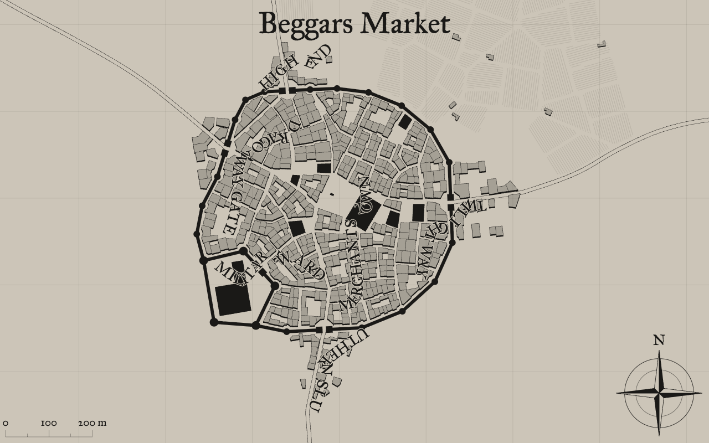

# Medieval City Generator — TypeScript

Der Originalalgorithmus von [Watabous Medieval Fantasy City Generator](https://watabou.github.io/city-generator/) **0.11.5, Build 2431**, aus dem ausgelieferten Haxe/JavaScript-Bundle nach TypeScript portiert. Die vorherige angenäherte Generierung wurde vollständig ersetzt.

Der vorgegebene Seed `924709892` erzeugt **Beggars Market**. Nach der Wiederherstellung bestehen 24 direkte Vergleiche gegen das unabhängig ausgeführte Originalbundle: ungerundete Koordinaten, Grundstücke, Gebäude, Bezirke, Namen, Wege, Gewässer, Mauern und abschließender Zufallszustand.

Die früheren acht Browserreferenzdateien fehlen im Chatarchiv. `tests/fixtures/original/` enthält neu erzeugte **Node-Referenzen**, ausdrücklich keine geretteten Browseraufnahmen. Die historischen Analyseberichte unten beschreiben die damaligen Beobachtungen. Sie sind kein neuer Browsertest. Details: [Wiederherstellung](../../docs/recovery.md).



## Start

```sh
npm ci
npm run dev
```

Die lokale Anwendung läuft normalerweise auf `http://localhost:5173`. Seed und Optionen des Referenzlinks sind voreingestellt.

```sh
npm test                  # Integration, 24 Originalvergleiche, Darstellung, URL, Warp
npm run test:parity        # Nur die unabhängigen Originalvergleiche
npm run build             # TypeScript Strict und Produktionsbuild
npm run preview           # Produktionsbuild lokal öffnen
npm run regenerate:kernel # Reproduzierbare Extraktion und TS-Generierung
```

Die Paritätstests laden auf einem neuen Checkout das Originalbundle einmal nach `.rea/original/` und prüfen dessen festgelegten SHA-256. Bei fehlendem Netz oder geändertem Original schlagen sie fehl; sie werden nicht stillschweigend übersprungen. Anschließend verwenden sie den lokalen Cache. Der Anwendungsbuild benötigt dieses Bundle nicht.

`npm run oracle` startet zusätzlich die echte Originalanwendung lokal auf Port 5175. Für `/scripts/browser-parity.html` müssen zuvor neue Browserreferenzen über diesen Oracle erfasst werden; die wiederhergestellten Node-Referenzen eignen sich wegen laufzeitabhängiger Math-Ergebnisse nicht dafür. Der frühere Browserbericht ist nicht wiederhergestellt.

## Aufbau

| Datei | Aufgabe |
| --- | --- |
| `src/original/kernel.ts` | Originaler Generierungskern einschließlich DCEL, Triangulation, Vierteln, Grundstücksteilung, Zufallsfolge und Namen |
| `src/original/assets/` | Unveränderte Namensgrammatik und Sprachkorpora |
| `src/original/provenance.json` | Originalversion, Bundle-Hash, Asset-Hashes und Klassenherkunft |
| `scripts/extract-original.mjs` | AST-basierte Extraktion, lesbare Klassennamen und explizite TypeScript-Annotationen |
| `src/model/generator.ts` | Typisierte API mit isoliertem Zustand je Stadt |
| `src/model/original-adapter.ts` | Übernahme der Originalgeometrie in das serialisierbare Kartenmodell |
| `src/render/map.ts` | SVG-Darstellung der Originalpolygone und Zeichenpfade |
| `src/main.ts`, `src/state.ts` | HTML-Oberfläche, URL-Optionen und Bedienung |
| `src/warp.ts`, `src/export.ts` | Verformung, Undo und SVG-/PNG-/JSON-Export |

Die mechanisch portierten Haxe-Interna verwenden ausdrücklich `HaxeValue = any`. Das erhält die ursprünglichen Prototypen, Enum-Identitäten und dynamischen Datenstrukturen; es wird kein `ts-nocheck` eingesetzt. Öffentliche Optionen, Geometrie, Adapter und Renderer sind typisiert. Die Produktion lädt weder das Originalbundle noch ein iframe.

```ts
import { generateCity } from './src/model/generator';
import { DEFAULT_OPTIONS } from './src/state';

const city = generateCity({ ...DEFAULT_OPTIONS, size: 40, seed: 12345 });
// city.wards[].buildings[].polygon: tatsächliche Originalgrundrisse
// city.originalGeometry: Originalmauern, Gewässer, Wege, Baumkronen und Felder
```

## Oberfläche und Umfang

Die Zufallsauswahl der Merkmale verwendet den Original-Blueprint einschließlich zufälliger Küstenrichtung; „Maximum“ verwendet den ursprünglichen Hub-Modus. Seed, Stadtgröße, Zitadelle, innere Burg, Marktplatz, Tempel, Mauern, Vororte, Küste, Fluss, Grünflächen und Tore sind einstellbar. Die Karte unterstützt Zoom, Verschieben, vier Warp-Pinsel mit Undo, Originalnamen, sechs Farbpaletten, lokale Originalschriften und Exporte.

`Enter` erzeugt eine neue Stadt, `G` öffnet Generate, `T` Settlement, `S` Style, `C` Colors, `W` Warp. `L` schaltet Bezirksnamen, `D` das Raster, `0` setzt die Ansicht zurück. `1`–`6` wählen Farbpaletten.

Die Algorithmusparität bezieht sich auf die Originalgenerierung im Standardmodus **Lots**. HTML-Bedienung und SVG-Ausgabe bleiben eine eigenständige Umsetzung; eine pixelidentische Kopie der vollständigen OpenFL-Anwendung wird nicht behauptet. Wappen, POI-Editor, Legenden, zusätzliche Warp-Werkzeuge und die Darstellungsmodi Complex/Simple sind nicht in der Oberfläche umgesetzt. Optionale Dachfirstlinien sind schematische Darstellung. Das JSON-Exportformat bleibt `new-cities`, Version 1.

Weitere Details, REA-Evidenz und Grenzen: [Analysebericht](docs/reverse-engineering.md), [Originalvergleich](docs/oracle-notes.md).

Originalalgorithmus und Gestaltung: **Oleg Dolya / Watabou**. Die mitgelieferten Schriften stehen unter der SIL Open Font License; Lizenztexte liegen unter `public/fonts/`.
