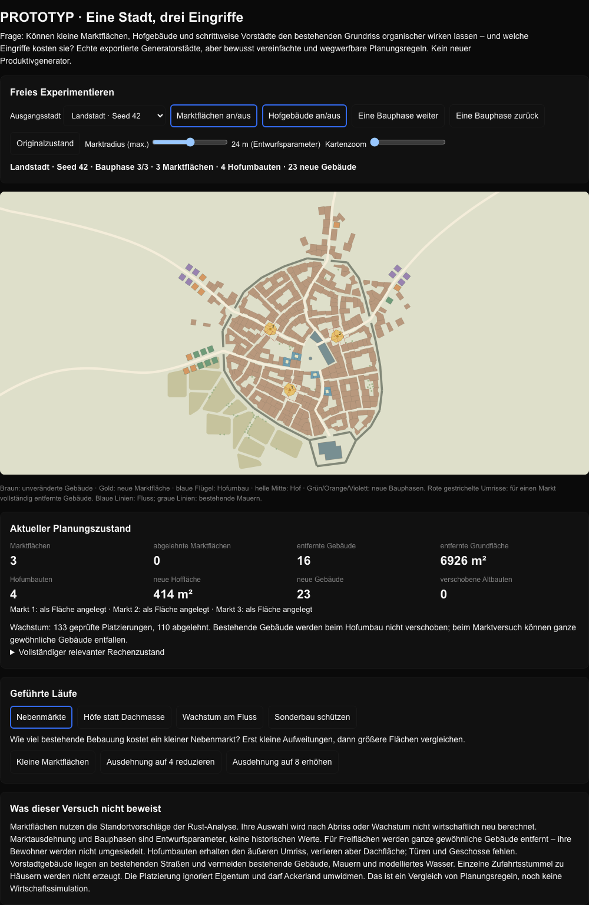

# Wegwerfprototyp: organische Stadtentwicklung

Frage: Wie verändern echte Nebenmarktflächen, Hofumbauten und Vorstadt-Bauphasen einen bestehenden Stadtgrundriss, und welche Eingriffe kosten sie? Dieses Verzeichnis enthält Wegwerfprototypen und primäre Experimentquellen, keine produktive Generatorerweiterung. Die Dateien liegen zur gemeinsamen Betrachtung im PR-Branch und werden nicht von der Rust-Anwendung geladen oder kompiliert.

## Runde 2: Marktwege und Distrikte

`market-district-lab.html` per Doppelklick öffnen: Die neue Standortlogik hat getrennte Mindestlaufwege zum Hauptmarkt und zwischen Nebenmärkten, ein weiches Distriktgewicht ohne Marktpflicht und eine einstellbare Mindestnachfrage. Wege, Ablehnungsgründe und Versorgung über Distriktgrenzen sind direkt sichtbar. Diese Ansicht erzeugt keine Marktflächen, Höfe oder Neubauten.

```sh
node crates/city_core/prototypes/run-market-district-lab.mjs
```

`market-district-runs.json` enthält 27 weitere reproduzierte Läufe. [Ergebnisse und Grenzen](../../../docs/market-district-experiment.md). Die neuen Regeln sind nicht in den Rust-Generator übernommen; Parameter und Gestaltung sind nicht freigegeben.

## Runde 1: Interaktiv öffnen

`organic-city-lab.html` herunterladen und per Doppelklick öffnen. Kein Server und keine Installation nötig. Die Datei enthält drei echte exportierte Städte samt der reinen Planungsfunktionen. Freies Experimentieren, vier geführte Läufe, Kartenzoom und der vollständige relevante Rechenzustand sind eingebaut.



## Runde-1-Läufe reproduzieren

Mit vorhandenem Node:

```sh
node crates/city_core/prototypes/run-organic-city-lab.mjs
```

Das Skript führt exakt das reine Planungsmodul der HTML-Datei für neun Konfigurationen auf drei Städten aus. Es benötigt keine Pakete, erzeugt keine Tests und schreibt nur JSON auf stdout. `organic-city-runs.json` hält die 27 tatsächlich ausgeführten Läufe, die HTML-Prüfsumme und die Node-Version fest.

Ausgangsstädte: Größe 25, Seed 42 mit/ohne Fluss und Seed 12345 ohne Fluss, jeweils aus der Rust-Anwendung mit `--economy --export`. Grundlage ist Commit `8d73abc6ceb6a18c83e8ee87a6cc8c4e5ac4917c`. Für die eingebettete Geometrie wurden Koordinaten auf vier Nachkommastellen gerundet; dies ist keine Originaltreue-Referenz.

## Regeln und Grenzen

- Märkte verwenden vorhandene Standortvorschläge der Rust-Analyse. Unregelmäßige siebeneckige Flächen mit maximal 16/24/32 Metern Radius werden auf Wasser-, Mauer- und Sonderbaukonflikte geprüft. Gewöhnliche überlappende Gebäude werden vollständig entfernt; verlorene Gebäude und Grundfläche werden ausgewiesen. Keine Umsiedlung, Kapazitäts- oder Nachfrage-Neuberechnung.
- Hofumbauten zerlegen bis zu zwölf geeignete große, konvexe Gebäude in Flügel um einen Innenhof; Außenumriss bleibt erhalten, Dachfläche entfällt. Keine Geschosse, Türen oder Grundstücksrekonstruktion.
- Drei Bauphasen ergänzen jeweils höchstens acht gleich große Häuser an bestehenden Ausfallstraßen in Tornähe. Abgewiesen werden modellierte Wasser-, Mauer-, Straßen- und Gebäudekonflikte; Zugänge erhalten eine einfache Verbindung zur Straße. Kein neues Straßennetz, keine Nachfrage- oder Preisentscheidung; Ackerland darf umgewidmet werden. Sichtbare Reihenförmigkeit ist eine Grenze dieses Ansatzes.

## Beobachtete Ergebnisse

| Stadt | Marktflächen bei Radius max. 24 m | dafür entfernte Gebäude | geeignete Hofumbauten allein | neue Gebäude nach drei Phasen |
| --- | ---: | ---: | ---: | ---: |
| Landstadt, Seed 42 | 3 | 16 | 4 | 23 |
| Flussstadt, Seed 42 | 3 | 19 | 4 | 20 |
| Cloudhill, Seed 12345 | 3 | 20 | 5 | 15 |

Bei maximal 16 Metern Radius entfallen 13/12/13 Gebäude, bei maximal 32 Metern 24/30/20. In Cloudhill wird bei der größten Ausdehnung ein Standort wegen eines Sonder- oder Landwirtschaftsgebäudes abgelehnt; deshalb bleiben dort nur zwei Marktflächen übrig. Die Werte sind Outputs dieser vereinfachten Regeln, keine kalibrierten historischen oder stadtökonomischen Größen.

## Vorläufige Antworten, noch keine Produktentscheidung

1. Marktstandorte müssen den Eingriff in vorhandene Bebauung berücksichtigen. Erreichbarkeit allein genügt nicht. Freie Restflächen und Straßenaufweitungen vor Abriss zu suchen ist ein nächster Versuch, nicht bereits validiert.
2. Höfe nur in große Einzelgebäude zu schneiden ist zu eingeschränkt; als nächster Versuch sind Grundstücks-/Blockgruppen interessanter.
3. Schrittweises Wachstum kann die Altstadt unverändert lassen, wirkt mit gleich großen Häusern an vorhandenen Straßen aber weiterhin geplant. Unterschiedliche Grundstücke, Zugangswege und lokale Nachfrage fehlen.

Die drei angewendeten Ansätze wurden als HTML-Ansichten ausgeführt und angesehen, einschließlich des abgewiesenen Marktstandorts. Produktionscode wurde nicht verändert und keine Hypothese automatisch übernommen. Der zugehörige PR enthält diese Dateien zusammen mit der [Ergebnisspur und den Gestaltungsregeln](../../../docs/organic-city-experiments.md).
