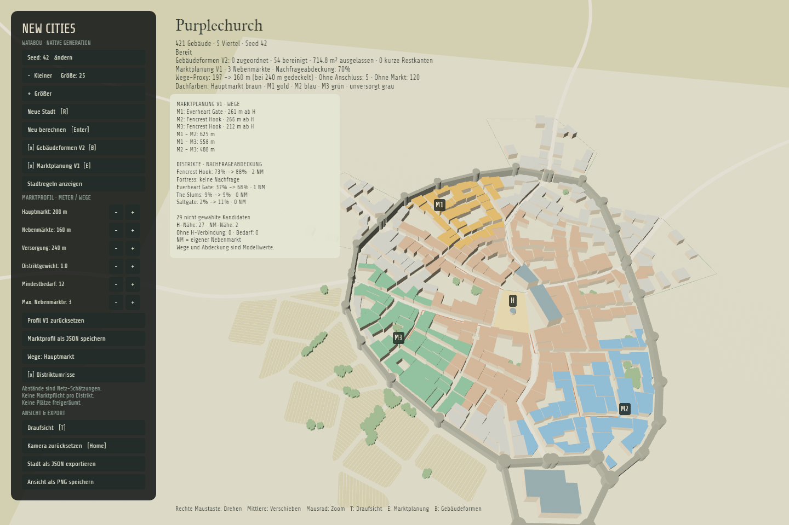

# Gebäudeformen V2

Zuschaltbare native Grundrissbereinigung: V1 ordnet schmale Reststreifen seitlich Nachbargebäuden zu; V2 ergänzt die akzeptierte **Variante B mit 6-m-Kappung und anschließender Bereinigung von Kanten unter 2 m**. Der [Aufteilungs-Draft](../crates/city_core/prototypes/building-joins-draft.html) und der [B-/Kanten-Draft](../crates/city_core/prototypes/building-corners-draft.html) bleiben als eingefrorene historische Referenzen erhalten. Ihre Experimentierhinweise beschreiben den damaligen Stand.

## Starten und vergleichen

```sh
# Dieselbe Purplechurch-Stadt wie in PR #1, Gebäudeplanung aus:
cargo run -- --seed 42 --size 25 --economy
# Nur Gebäudeplanung zusätzlich einschalten:
cargo run -- --seed 42 --size 25 --economy --buildings
cargo run -- --seed 42 --size 25 --economy --building-profile assets/building-profiles/buildings-v2.json
# Frühere V1-Planung ohne die neuen Bereinigungsschritte wiedergeben:
cargo run -- --seed 42 --size 25 --economy --building-profile assets/building-profiles/buildings-v1.json
cargo run -- --write-building-profile exports/building-profile.json
cargo run -- --seed 42 --size 25 --economy --buildings --export exports/planned-city.json
```

Die Abnahme verwendet **Purplechurch, Seed 42, Größe 25 aus PR #1**, nicht eine andere Stadt. Der [eigenständige HTML-Vergleich](building-planning-v2-comparison.html) zeigt native Umschalt-/Wischbilder und einen markierten Detailausschnitt. Die Datei herunterladen und per Doppelklick öffnen; kein Server erforderlich. [Eingaben und Prüfsummen](building-planning-v2-comparison.json) halten die tatsächlichen Vergleichsbedingungen fest. Ausgangsstadt und Marktanalyse stimmen vollständig mit dem gespeicherten PR-#1-Export überein; beide Bilder verwenden dieselbe aktuelle Anwendung, Kamera, Auflösung und Profile.

In Purplechurch bleibt es bei 422 → 421 Gebäuden: Wie in V1 entfällt `21:8` (etwa 158 m², 5,82 m kurze Umhüllungsseite unter der 6-m-Versuchsvorgabe). V2 bereinigt zusätzlich 54 erhaltene Gebäude; keine Kante gewöhnlicher Gebäude bleibt hier unter 2 m. Insgesamt werden etwa 714,84 m² ausgelassen. Es gibt hier keine Zusammenführung. Alle übrigen Stadtgeometrien bleiben identisch.

Der abgenommene Bildfall `21:7` wird von 236,44 m² auf 190,81 m² mit fünf Ecken verkleinert: B lässt zunächst 200,18 m² stehen; das Entfernen der 1,21-/1,46-m-Restkanten kostet weitere 9,37 m². Die native Geometrie stimmt innerhalb der numerischen Toleranz mit dem akzeptierten Draft überein. Das sind Profilwirkungen, keine historischen Nutzbarkeitsnachweise. Der [frühere V1-Vergleich](building-planning-v1-comparison.html) bleibt separat verfügbar.

Mit `B` oder dem Seitenleistenknopf „Gebäudeformen V2“ zwischen Original und geplanter Bebauung wechseln. Ohne Schalter bleibt der Originalmodus aktiv. Die Kamera bedient sich wie bisher; Statuszeile und Export weisen zugeordnete Teile, bereinigte Gebäude, ausgelassene Grundfläche und verbleibende kurze Kanten aus. Ohne Marktüberlagerung behalten unveränderte Gebäude ihre bisherigen Darstellungsfarben und abgeleiteten Höhen.

Das [V2-Standardprofil](../assets/building-profiles/buildings-v2.json) übernimmt die V1-Grenzen: 24 m² Fläche, 6 m kurze und 4 m lange Umhüllungsseite, 25° kleinster konvexer Winkel sowie 6 m Mindest-Anschlusslänge für seitliche Streifenabschnitte. Hinzu kommt `refinement: {"trimTips": true, "minEdgeM": 2.0}`. `trimTips: false` schaltet nur die Kappung aus; `minEdgeM: 0` deaktiviert die Kantenbereinigung. Die Kappung verwendet `minWidthM` auch als Abschlussbreite und Mindestlänge der schmalen Endzone.

Profilversion 1 ohne `refinement` bleibt nachspielbar; Version 2 verlangt dieses Objekt. Flächen-/Längenwerte müssen endlich und positiv sein, `minEdgeM` endlich und nichtnegativ, der Winkel zwischen 0° und 90°. Die Minima sind unabhängig; die 6-m-Breitenvorgabe macht die niedrigere Tiefenvorgabe redundant. **Konfigurierbare Versuchswerte, keine historischen Normen oder zertifizierten Raummaße.**

## Regeln und Bilanz

- Nur gewöhnliche `lot`-Gebäude ohne Landmark-Kennzeichen werden bearbeitet. Sonderbauten bleiben unverändert.
- Flächen-, Umhüllungsmaß- und Winkelprüfungen erkennen beanstandete Formen. Unauffällige unregelmäßige Grundrisse werden nicht pauschal rechteckig gemacht.
- Schmale konvexe Vierecke werden an echten gemeinsamen Längswandabschnitten geteilt. Kollineare Zwischenpunkte werden vorher normalisiert. Jeder Teil muss vollständig entlang seiner Anschlusskante anliegen; kurze Kontakte und mehrdeutige Zuordnungen werden abgewiesen.
- Ein schmaler Streifen ohne Längsanschluss wird nicht über die Stirnseite verbunden. Kompliziertere weiterhin schmale Formen bekommen ebenfalls keinen solchen Fallback.
- Andere kleine Formen können mit einem direkten geeigneten Nachbarn vereinigt werden. Längere gemeinsame Wände werden bevorzugt. Reine Eckberührung, räumliche Nähe und Verbindungsstücke über Lücken reichen nicht.
- Jeder Empfänger muss schon vor der Zuordnung die Formindikatoren bestehen und erhält höchstens eine Zuordnung. So entstehen keine Kettenvereinigungen ganzer Quartiere. Vereinigung und Teilung erzeugen keine zusätzliche Fläche; modellierte Straßen, Wege, Mauern und Gewässer dürfen nicht eingeschlossen werden.
- Nach den Zuordnungen verfeinert V2 erhaltene gewöhnliche Gebäude ausschließlich innerhalb ihrer bisherigen Kontur. Die Richtung wird aus der längsten Randkante ermittelt, beide Enden werden geprüft. Höchstens eine Kappung pro Gebäude: Die schmale Endzone muss mindestens `minWidthM` lang sein; die erste gefundene ausreichend breite Querlinie muss auch an den Messlinien 1 m und 2 m dahinter ausreichend breit sein. Bei zwei zulässigen Enden gewinnt der kleinere Abtrag. Normale schnell breiter werdende Ecken werden nicht pauschal gekappt.
- Danach werden Kanten strikt unter `minEdgeM` durch Entfernen eines ihrer Eckpunkte vereinfacht. Die sichere Variante mit dem kleinsten Flächenverlust gewinnt. Neue Verbindungen müssen im alten Grundriss liegen; einfache Kontur und bisherige Formindikatoren müssen bestehen bleiben. Nach jedem Schritt werden alle Kanten erneut geprüft. Genau 2 m bleibt bei 2-m-Vorgabe bestehen. Ist keine sichere Vereinfachung möglich, bleibt die Kante erhalten und wird als kurze Restkante gezählt; geschützte Bauten sind davon ausgenommen.
- Nicht zuordenbare oder abgeschnittene Teile bleiben unbebaut, ohne automatische Hof-/Gartennutzung. Die Flächenbilanz prüft Originalgrundfläche = geplante Grundfläche + ausgelassene Grundfläche.

Im Bildfall `2:66` gehen rund 128,5 m² an `2:67` und `2:68`; 27,3 m² bleiben unbebaut. Die abgelehnte Stirnseitenvereinigung mit `2:69` entsteht nicht. IDs in Entscheidungen bezeichnen immer den ursprünglichen Quartier-/Gebäudeindex.

## Rust-Schnittstelle und Export

`plan_buildings(&city, &profile)` liefert einen `BuildingPlan` mit einer getrennten `city`, `profile`, `decisions`, `building_origins` und `summary`. Die Eingabestadt und ihr Zufallszustand bleiben unverändert. Alle übrigen Stadtgeometrien und Optionen werden kopiert. `building_origins` ordnet neue Gebäudeindizes den beibehaltenen ursprünglichen Empfängerindizes zu; damit bleiben Darstellung und Herkunft nachvollziehbar.

Eine Entscheidung `kind: "refine"` behält das Gebäude und seine ursprüngliche Identität bei: `polygon` enthält den neuen Grundriss, `discarded` den Abtrag, `assignments` bleibt leer. `refinedBuildings` zählt diese Entscheidungen; `omittedBuildings` zählt nur tatsächlich ausgelassene Gebäude. `flaggedBuildings` enthält jetzt auch erhaltene bereinigte Gebäude und ist daher keine Abrisszahl. `remainingShortEdges` zählt nicht sicher entfernbar gebliebene kurze Kanten gewöhnlicher Gebäude.

JSON ohne Gebäudeplanung bleibt Formatversion 1. Bei aktiver Planung wird **Version 2** exportiert:

- `city`: die tatsächlich angezeigten geplanten Gebäude;
- `originalCity`: vollständige unveränderte Ausgangsstadt;
- `buildingPlanning`: Profil, Entscheidungen, Flächenbilanz und `buildingOrigins`;
- optional `economy`: neu auf `city` berechnete Marktplanung, mit deren aktuellen Gebäudeindizes.

`--snapshot` bleibt ein Originaltreue-Nachweis und lehnt `--buildings` sowie `--economy` ab. Im laufenden Programm stellt Ausschalten der Gebäudeplanung wieder den Originalbestand her, statt bereits bearbeitete Gebäude erneut umzubauen.

## Prüfen und Grenzen

```sh
cargo test --workspace
cargo fmt --all --check
cargo clippy --workspace --all-targets -- -D warnings
node tools/verify-building-draft.mjs
node tools/verify-building-refinement.mjs
cargo run -- --seed 42 --size 25 --economy --screenshot exports/buildings-original.png --smoke-test
cargo run -- --seed 42 --size 25 --economy --buildings --screenshot exports/buildings.png --smoke-test
```

Die neun eingefrorenen Aufteilungs-Konfigurationen werden mit Profil V1 gegen Rust verglichen. V2 wird zusätzlich gegen den eingefrorenen B-/Kanten-Draft geprüft, einschließlich des nativen Bildfalls ohne festgelegte ID oder Achse, Rotation, Verschiebung und umgekehrter Umlaufrichtung. Gegenproben schützen exakt 2 m lange Kanten, konkave Kerben sowie ausreichend breite Rechteck-, L- und U-Formen. Weitere Prüfungen decken Originaltreue, deterministische Flächenbilanz, geschützte Gebäude, Eck-/Lücken-/Wege-Gegenbeispiele, kollineare Restformen, gemischte Städte sowie native Umschaltung, Marktneuberechnung und Export ab. Automatisierte Rendernachweise laufen unsichtbar und ignorieren Desktop-Tastatureingaben, damit der Seed während der Aufnahme nicht verändert wird.

### Gleiche Abnahmestadt wie PR #1




### Zusätzlicher Aufteilungsfall: Stormwind

Stormwind bleibt ein getrennter Testfall für die seitliche Aufteilung, ersetzt aber nicht die bekannte Abnahmestadt:

```sh
cargo run -- --options assets/city-options/stormwind.json --building-profile assets/building-profiles/buildings-v1.json
```


V2 ist keine neue Parzellierung und keine allgemeine Rekonstruktion nutzbarer Innenräume. Die konservative längste-Randkante-Prüfung ist keine vollständige Erkennung sämtlicher Flügel oder innerer Engstellen. Türen, Belichtung, Geschosse, reale Eigentumsrechte und Umsiedlung bleiben offen. Ausgelassene Dachgrundfläche ist keine kalibrierte Einwohner- oder Wohnraumzahl. Der Originalmodus bleibt deshalb verfügbar; die alten Hof- und Wachstumsregeln werden nicht übernommen.
