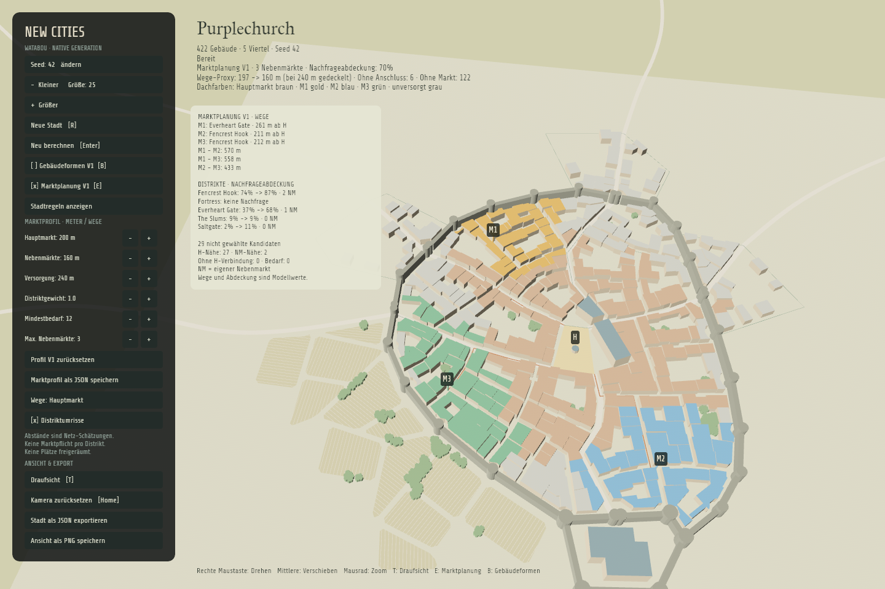
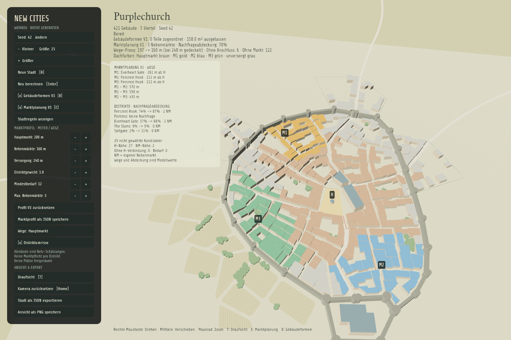

# Gebäudeformen V1

Zuschaltbare native Umsetzung des akzeptierten [Aufteilungs-Drafts](../crates/city_core/prototypes/building-joins-draft.html): schmale Reststreifen seitlich Nachbargebäuden zuordnen, statt sie als dünnen Arm über die Stirnseite anzuhängen. Der HTML-Draft bleibt als historische Referenz eingefroren; sein Freigabehinweis beschreibt den damaligen Experimentierstand.

## Starten und vergleichen

```sh
# Dieselbe Purplechurch-Stadt wie in PR #1, Gebäudeplanung aus:
cargo run -- --seed 42 --size 25 --economy
# Nur Gebäudeplanung zusätzlich einschalten:
cargo run -- --seed 42 --size 25 --economy --buildings
cargo run -- --seed 42 --size 25 --economy --building-profile assets/building-profiles/buildings-v1.json
cargo run -- --write-building-profile exports/building-profile.json
cargo run -- --seed 42 --size 25 --economy --buildings --export exports/planned-city.json
```

Die Abnahme verwendet **Purplechurch, Seed 42, Größe 25 aus PR #1**, nicht eine andere Stadt. Der [eigenständige HTML-Vergleich](building-planning-v1-comparison.html) zeigt native Umschalt-/Wischbilder und einen markierten Detailausschnitt. Die Datei herunterladen und per Doppelklick öffnen; kein Server erforderlich. [Eingaben und Prüfsummen](building-planning-v1-comparison.json) halten die tatsächlichen Vergleichsbedingungen fest. Ausgangsstadt und Marktanalyse stimmen vollständig mit dem gespeicherten PR-#1-Export überein; beide Bilder verwenden dieselbe aktuelle Anwendung, Kamera, Auflösung und Profile.

In dieser Stadt entfällt bei unverändertem V1-Profil nur `21:8`: etwa 158 m², 5,82 m kurze Umhüllungsseite unter der 6-m-Versuchsvorgabe. Es gibt hier keine Zusammenführung. Alle übrigen Gebäudegrundrisse und übrigen Stadtgeometrien bleiben identisch. Das ist eine transparente Wirkung des Profils, kein historischer Nachweis für die Unbrauchbarkeit dieses Hauses.

Mit `B` oder dem Seitenleistenknopf „Gebäudeformen V1“ zwischen Original und geplanter Bebauung wechseln. Ohne Schalter bleibt der Originalmodus aktiv. Die Kamera bedient sich wie bisher; Statuszeile und Export weisen zugeordnete Teile und ausgelassene Grundfläche aus. Ohne Marktüberlagerung behalten unveränderte Gebäude ihre bisherigen Darstellungsfarben und abgeleiteten Höhen.

Das [V1-Profil](../assets/building-profiles/buildings-v1.json) enthält `version`, `name`, `minAreaM2`, `minWidthM`, `minDepthM`, `minAngleDegrees` und `minContactM`. Ausgangswerte: 24 m² Fläche, 6 m kurze und 4 m lange Umhüllungsseite, 25° kleinster konvexer Winkel sowie 6 m Mindest-Anschlusslänge für seitliche Streifenabschnitte. Die Minima sind unabhängig; die 6-m-Breitenvorgabe macht die niedrigere Tiefenvorgabe in diesem Profil redundant. **Das sind konfigurierbare Versuchswerte, keine historischen Normen oder zertifizierten Raummaße.** Profilversion 1 und endliche positive Flächen-/Längenwerte sind erforderlich; der Winkel liegt zwischen 0° und 90°.

## Regeln und Bilanz

- Nur gewöhnliche `lot`-Gebäude ohne Landmark-Kennzeichen werden bearbeitet. Sonderbauten bleiben unverändert.
- Flächen-, Umhüllungsmaß- und Winkelprüfungen erkennen beanstandete Formen. Unauffällige unregelmäßige Grundrisse werden nicht pauschal rechteckig gemacht.
- Schmale konvexe Vierecke werden an echten gemeinsamen Längswandabschnitten geteilt. Kollineare Zwischenpunkte werden vorher normalisiert. Jeder Teil muss vollständig entlang seiner Anschlusskante anliegen; kurze Kontakte und mehrdeutige Zuordnungen werden abgewiesen.
- Ein schmaler Streifen ohne Längsanschluss wird nicht über die Stirnseite verbunden. Kompliziertere weiterhin schmale Formen bekommen ebenfalls keinen solchen Fallback.
- Andere kleine Formen können mit einem direkten geeigneten Nachbarn vereinigt werden. Längere gemeinsame Wände werden bevorzugt. Reine Eckberührung, räumliche Nähe und Verbindungsstücke über Lücken reichen nicht.
- Jeder Empfänger muss schon vor der Änderung die Formindikatoren bestehen und wird höchstens einmal verändert. So entstehen keine Kettenvereinigungen ganzer Quartiere. Vereinigung und Teilung erzeugen keine zusätzliche Fläche; modellierte Straßen, Wege, Mauern und Gewässer dürfen nicht eingeschlossen werden.
- Nicht zuordenbare Teile bleiben unbebaut, ohne automatische Hof-/Gartennutzung. Die Flächenbilanz prüft Originalgrundfläche = geplante Grundfläche + ausgelassene Grundfläche.

Im Bildfall `2:66` gehen rund 128,5 m² an `2:67` und `2:68`; 27,3 m² bleiben unbebaut. Die abgelehnte Stirnseitenvereinigung mit `2:69` entsteht nicht. IDs in Entscheidungen bezeichnen immer den ursprünglichen Quartier-/Gebäudeindex.

## Rust-Schnittstelle und Export

`plan_buildings(&city, &profile)` liefert einen `BuildingPlan` mit einer getrennten `city`, `profile`, `decisions`, `building_origins` und `summary`. Die Eingabestadt und ihr Zufallszustand bleiben unverändert. Alle übrigen Stadtgeometrien und Optionen werden kopiert. `building_origins` ordnet neue Gebäudeindizes den beibehaltenen ursprünglichen Empfängerindizes zu; damit bleiben Darstellung und Herkunft nachvollziehbar.

JSON ohne Gebäudeplanung bleibt Formatversion 1. Bei aktiver Planung wird **Version 2** exportiert:

- `city`: die tatsächlich angezeigten geplanten Gebäude;
- `originalCity`: vollständige unveränderte Ausgangsstadt;
- `buildingPlanning`: Profil, Entscheidungen, Flächenbilanz und `buildingOrigins`;
- optional `economy`: neu auf `city` berechnete Marktplanung, mit deren aktuellen Gebäudeindizes.

`--snapshot` bleibt ein Originaltreue-Nachweis und lehnt `--buildings` sowie `--economy` ab. Im laufenden Programm stellt Ausschalten der Gebäudeplanung wieder den Originalbestand her, statt bereits bearbeitete Gebäude erneut umzubauen.

## Prüfen und Grenzen

```sh
cargo test --workspace
cargo fmt --all --check
cargo clippy --workspace --all-targets -- -D warnings
node tools/verify-building-draft.mjs
cargo run -- --seed 42 --size 25 --economy --screenshot exports/buildings-original.png --smoke-test
cargo run -- --seed 42 --size 25 --economy --buildings --screenshot exports/buildings.png --smoke-test
```

Die neun eingefrorenen Draft-Konfigurationen werden gegen Rust verglichen. Weitere Prüfungen decken Originaltreue, deterministische Flächenbilanz, geschützte Gebäude, Eck-/Lücken-/Wege-Gegenbeispiele, kollineare Restformen, gemischte Städte sowie native Umschaltung, Marktneuberechnung und Export ab. Automatisierte Rendernachweise laufen unsichtbar und ignorieren Desktop-Tastatureingaben, damit der Seed während der Aufnahme nicht verändert wird.

### Gleiche Abnahmestadt wie PR #1





### Zusätzlicher Aufteilungsfall: Stormwind

Stormwind bleibt ein getrennter Testfall für die seitliche Aufteilung, ersetzt aber nicht die bekannte Abnahmestadt:

```sh
cargo run -- --options assets/city-options/stormwind.json --buildings
```


V1 ist keine neue Parzellierung und keine allgemeine Rekonstruktion nutzbarer Innenräume. Lokale Engstellen in großen konkaven Baukörpern, Türen, Belichtung, Geschosse, reale Eigentumsrechte und Umsiedlung bleiben offen. Ausgelassene Dachgrundfläche ist keine kalibrierte Einwohner- oder Wohnraumzahl. Der Originalmodus bleibt deshalb verfügbar; die alten Hof- und Wachstumsregeln werden nicht übernommen.
