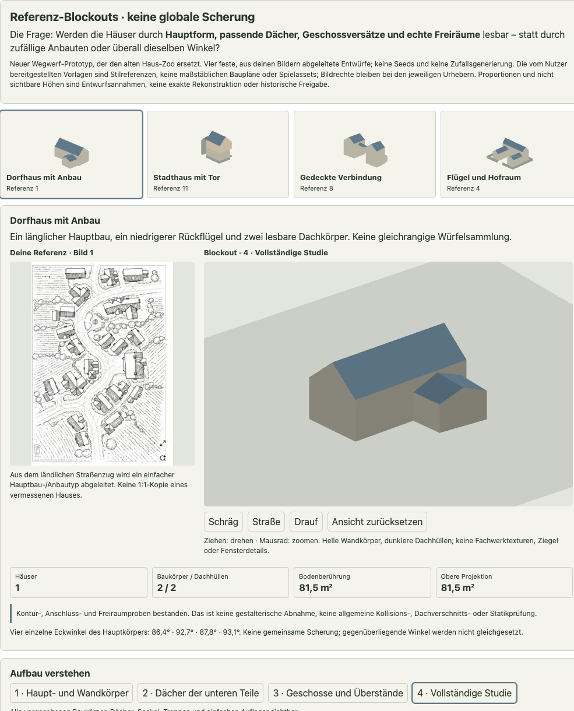
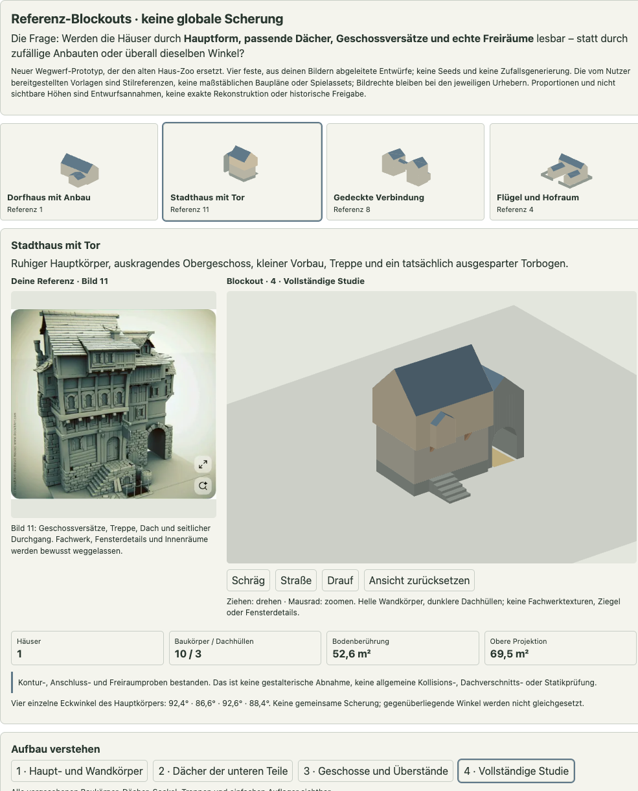
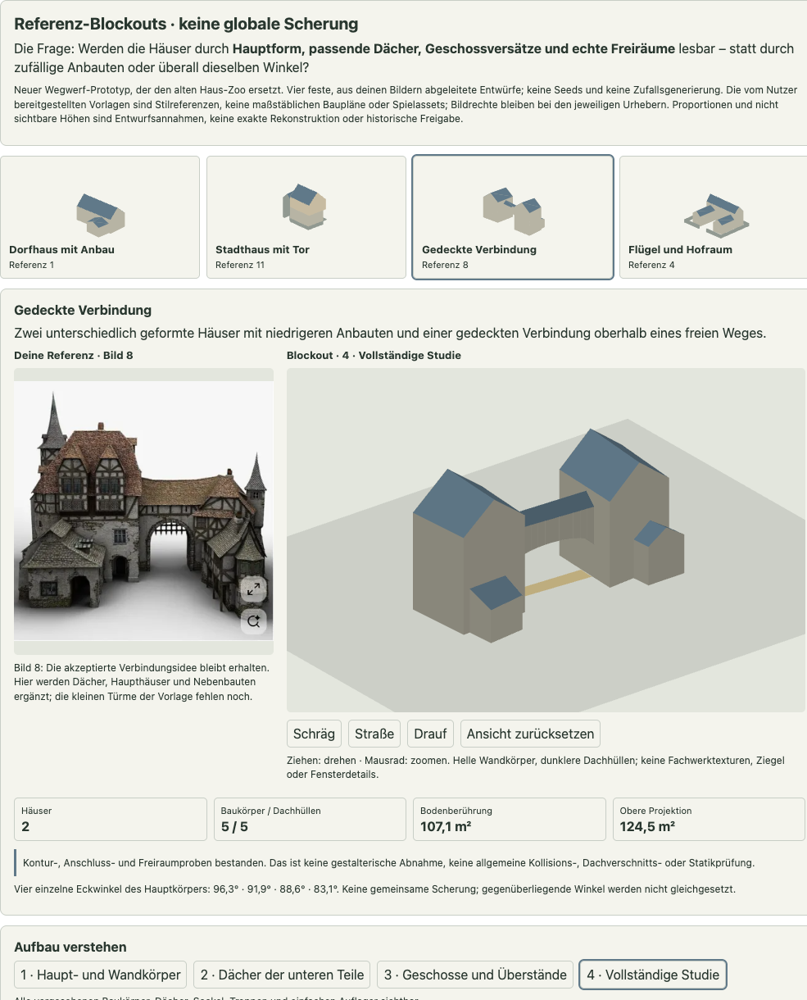
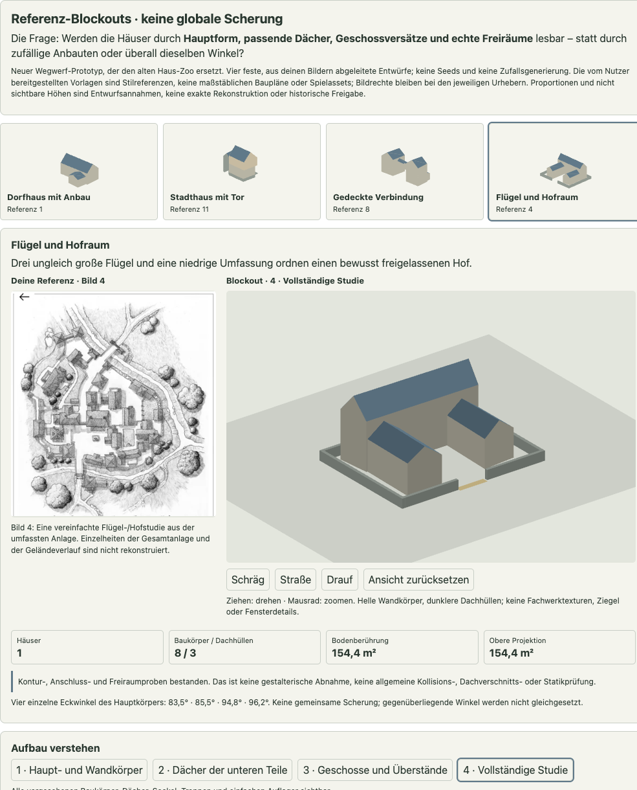

# Referenz-Blockouts statt des alten Haus-Zoos

Der frühere Haus-Zoo mit gemeinsamer Scherung und zufälligen Anbauvarianten ist verworfen und aus dem aktuellen Stand entfernt. Dieser neue, unabhängige Wegwerf-Prototyp untersucht **vier feste Referenzentwürfe mit Dächern, einzelnen Eckwinkeln, Geschossversätzen und wirklichen Freiräumen**. Er ersetzt noch keine Stadtgenerierung.

Die Verbindung zwischen Häusern war als Richtung akzeptiert; die übrigen früheren Formbeispiele waren es nicht. Auch die neuen Entwürfe sind **noch nicht gestalterisch abgenommen**. Technische Prüfungen weisen weder Architekturqualität noch historische oder statische Richtigkeit nach.

## Öffnen

1. [Eigenständige HTML-Datei](../crates/city_core/prototypes/house-blockout-lab.html) herunterladen und öffnen. Im macOS-Checkout: `open crates/city_core/prototypes/house-blockout-lab.html`.
2. Eine der vier Referenzstudien auswählen. Vorlage und räumlicher Blockout stehen nebeneinander; die Vorlagen sind für die Offline-Sichtung eingebettet.
3. Mit Ziehen drehen und mit dem Mausrad zoomen. Schräg-, Straßen- und Draufsicht wählen. „Ansicht zurücksetzen“ ändert nur die Kamera; Aufbaustufe und Durchgangs-Gegenprobe bleiben erhalten.
4. Die Aufbaustufen durchgehen: Wandkörper → Dächer → Geschosse/Überstände → vollständige Studie. Dies sind Ansichtsfilter eines festen Entwurfs, keine unterschiedlichen zufälligen Häuser.
5. Bei Stadthaus, Verbindung und Hof den Durchgang testweise schließen. Die rote Sperre und die erwartete Freiraummeldung müssen erscheinen; erneut klicken stellt den Ausgangszustand her.
6. Modell, Befunde und Ansicht bei Bedarf explizit als JSON speichern. Es gibt keine automatische dauerhafte Speicherung.

Kein Server, Paketdownload, Stadtcode oder GitHub Runner. Für die räumliche Ansicht wird WebGL benötigt. Ohne WebGL bleiben die Vorlagen, Grundrisse und der Modellstatus sichtbar.

## Referenzen und Annahmen

Die Nummern beziehen sich auf die elf vom Nutzer bereitgestellten Bilder in ihrer ursprünglichen Reihenfolge. Die eingebetteten Studienvorlagen sind verkleinerte vollständige Bilder, keine neu recherchierten Quellen. Bildrechte verbleiben bei den jeweiligen Urhebern; sie sind **keine zur Übernahme bestimmten Spielassets**.

- **Bild 1 → Dorfhaus mit Anbau:** ein länglicher Hauptbau und ein niedrigerer Rückflügel. Zwei Satteldächer mit unterschiedlicher Richtung. Abgeleiteter Gebäudetyp, keine exakte Kopie eines bestimmten vermessenen Hauses aus der Karte.
- **Bild 11 → Stadthaus mit Tor:** erhöhter Sockel, Treppe, unteres und vorspringendes oberes Geschoss, kleiner oberer Vorbau, einfache Konsolen und seitlicher Torflügel mit facettiertem Bogen. Haupt- und Nebendächer von Beginn an vorhanden.
- **Bild 8 → gedeckte Verbindung:** zwei unterschiedlich geformte Haupthäuser, niedrigere Nebenbauten und eine gedeckte Bogenverbindung. Unterkante der Verbindung mindestens 3 m; die vorgesehene Verbindungsebene liegt bei 4,4 m. Keine simulierte innere Erschließung. Die kleinen Türme und die Fassadengliederung der Vorlage fehlen noch.
- **Bild 4 → Flügel und Hofraum:** drei ungleich große Flügel und eine niedrige Umfassung mit freiem Eingang. Die Gesamtanlage und ihr Gelände werden nicht exakt rekonstruiert.

Alle Längen und Höhen sind **Entwurfsmaße**. Aus den Bildern wurden keine belastbaren Meterwerte, Geschosshöhen, Besitzgrenzen oder Nutzungen abgelesen. Besonders aus den Dachkarten lassen sich helle Dachhälften, Höfe und Schatten nicht pauschal als Bodenpolygone interpretieren.

Die übrigen Vorlagen bleiben relevant, sind aber noch keine zusätzlichen Blockouts:

- Bilder 2 und 3: Straßenfluchten, dichte Nachbarschaften, Blockränder und rückwärtige Bebauung.
- Bild 5: Hierarchie großer Flügel und runder beziehungsweise polygonaler Akzente.
- Bild 6: gewöhnliche und besondere Formen innerhalb desselben Stadtgefüges.
- Bild 7: Ufer, Stege und Wasserzugang als Gründe für Ausrichtung und Freiraum.
- Bilder 9 und 10: Türme, Erker, auskragende Teile und komplexere Dachgruppen.

## Regeln des neuen Versuchs

### Einzelne Kanten statt globaler Scherung

Die Grundrisse sind feste konvexe Vierecke mit unterschiedlichen Eckpunkten. Gegenüberliegende Winkel müssen weder gleich noch Gegenwinkel sein. Die tatsächlichen vier Hauptkörperwinkel werden angezeigt. Es gibt keinen globalen Winkelregler und keine Pflicht, jeden Eckpunkt zufällig zu versetzen.

Ein Anbau wird über einen konkreten Abschnitt einer Elternwand angeschlossen. Seine äußeren Ecken und Tiefen sind unabhängig davon festgelegt. So entsteht lokale Anschlussordnung, ohne dass sämtliche Häuser dieselben parallelen Achsen besitzen müssen. Eine starre Spiegelung einzelner Szenen richtet lediglich die Straßenseite zur anfänglichen Kamera aus; sie verändert die Winkel nicht.

### Hauptform, Nebenform und Dach gemeinsam

Ein großer Hauptbau bleibt lesbar; niedrigere oder kleinere Ergänzungen sind ihm nicht beliebig gleichgestellt. Die Nebenbauten enden überwiegend unterhalb des Hauptdachansatzes. Flügel und Hof sind eine bewusste Anordnung, kein nachträglich aus einem Haus ausgeschnittenes Loch.

Satteldächer besitzen geneigte Flächen, First und Giebel; Pultdächer eine geneigte Ebene. Bei unregelmäßigen Vierecken werden die Satteldachflächen über zwei Seitenebenen konstruiert. Der First darf entsprechend leicht in der Höhe variieren. Es handelt sich um einfache Dachhüllen, nicht um einen allgemeinen bautechnischen Dachstuhl- oder Dachverschnittsgenerator.

### Geschosse und tatsächliche Öffnungen

Untere und obere Konturen werden getrennt beschrieben. Der obere Vorbau, die Auskragung und einfache Konsolen sind ausdrücklich angelegte Teile, nicht bloß eine größere Gesamtfläche.

Torbögen bestehen aus seitlichen Pfeilern und zehn facettierten Bogenabschnitten. Die Verbindung verwendet zwölf Bogenabschnitte. Darunter existiert wirklich kein Hausvolumen; es wird nicht nur eine dunkle Öffnung auf eine geschlossene Wand gemalt. Anschlussöffnungen zu Innenräumen werden hingegen noch nicht modelliert.

Bodenberührung und obere Projektion werden getrennt als Polygon-Vereinigungsflächen bestimmt. Beim Tor zählen am Boden die Pfeiler, oben die vollständige Torhülle. Beim erhöhten Verbinder bleiben beide Häuser und der freie Weg unterscheidbar.

## Modell und technische Grenzen

Die reine Logik liegt im HTML-Block `blockout-logic`: `build(id, options)`, `inspect(scene)` und die Mesh-Ableitung kennen weder DOM noch WebGL oder Stadtcode. Der separate Ansichtsblock ist der Wegwerfrahmen. Modellzustände sind ohne Zufall reproduzierbar.

- Viererkonturen werden auf Endlichkeit, positive Fläche und Konvexität geprüft.
- Deklarierte Wandanschlüsse und geometrische Geschossauflager werden geprüft.
- Reservierte Wege und Öffnungen dürfen von den vereinfachten Wand-/Bogenkörpern bis zur angegebenen Höhe nicht belegt werden.
- Dach- und Körpernetze werden direkt aus diesen festen Konturen erzeugt. Das ist **keine allgemeine räumliche Kollisions-, Dachverschnitts- oder Statikprüfung**.
- Die Polygonflächenprüfung unterstützt die hier verwendeten konvexen Vierecke und ihre Vereinigungen; sie ist nicht mehr auf gemeinsam gescherte Rechtecke beschränkt.
- Runde Türme, Gauben, Walmdächer, Dachüberstände, Fachwerk, Fensterdetails, Türen, Innenräume und Geländevariation sind noch nicht enthalten.

## Nächste gestalterische Abnahme

Zunächst jede der vier Studien anhand ihrer Vorlage beurteilen: Sind Hauptform, Proportionen, Dachrichtung, Höhenhierarchie, Anbauten und Freiräume verständlich? Erst akzeptierte Grundformen werden später vorsichtig parametrisiert. Keine weitere große Zufallsgalerie und keine Stadtintegration vor dieser Sichtung.

Die frühere V1-/V2-Stadtbereinigung bleibt unabhängig als Vergleich verfügbar. Dieser Ersatz ändert keine Rust-Stadtmodelle, Marktregeln oder Originalreferenzen.

## Lokale Ergebnisspur

```sh
node crates/city_core/prototypes/run-house-blockout-lab.mjs
```

[Aufgezeichnete feste Zustände und Durchgangs-Gegenproben](../crates/city_core/prototypes/house-blockout-runs.json) · [lokaler Prüfnachweis und Prüfsummen](house-blockout-proof.json). Alle Ausführungen sind lokal; keine GitHub Actions oder Runner werden eingerichtet oder ausgelöst.








