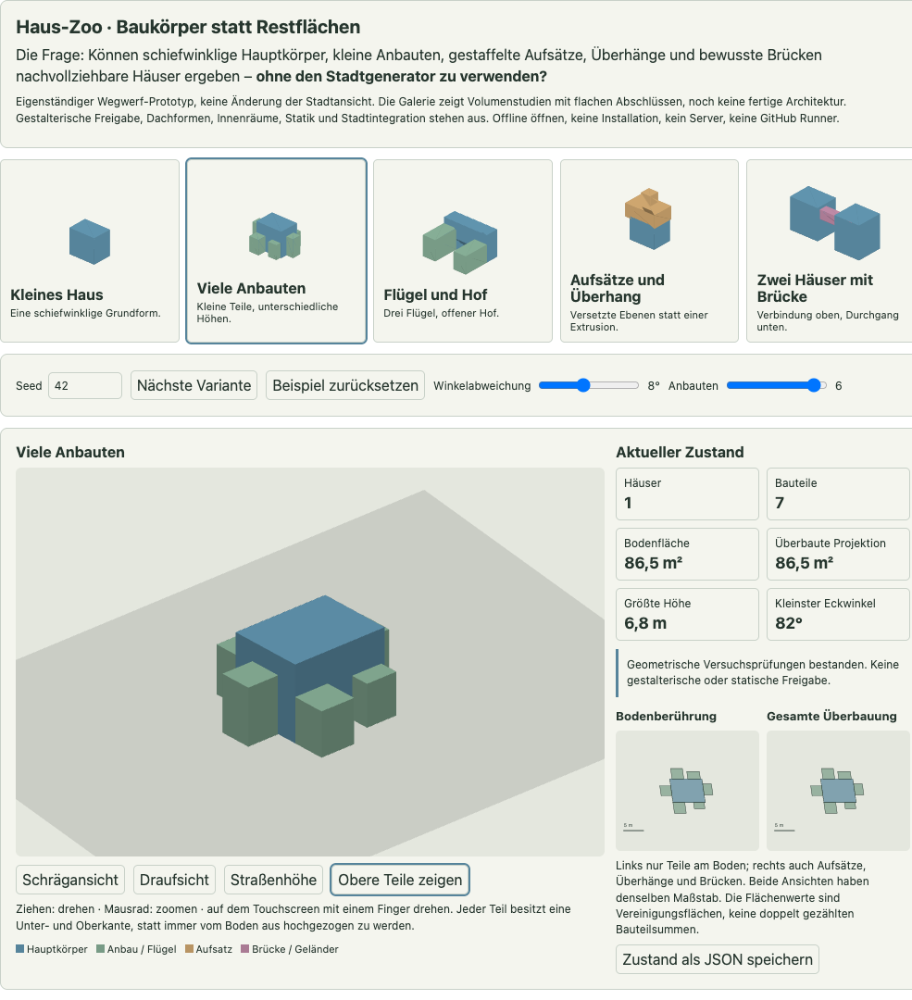
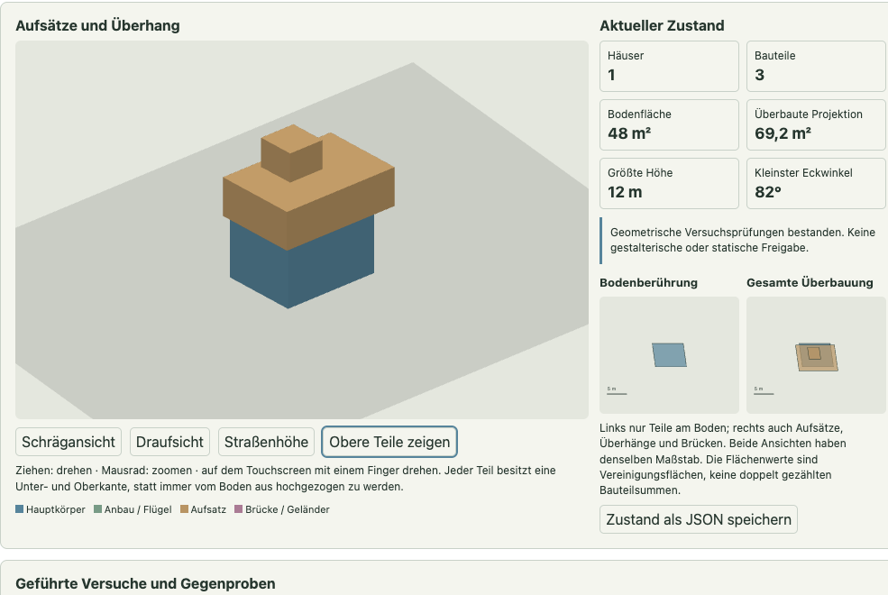
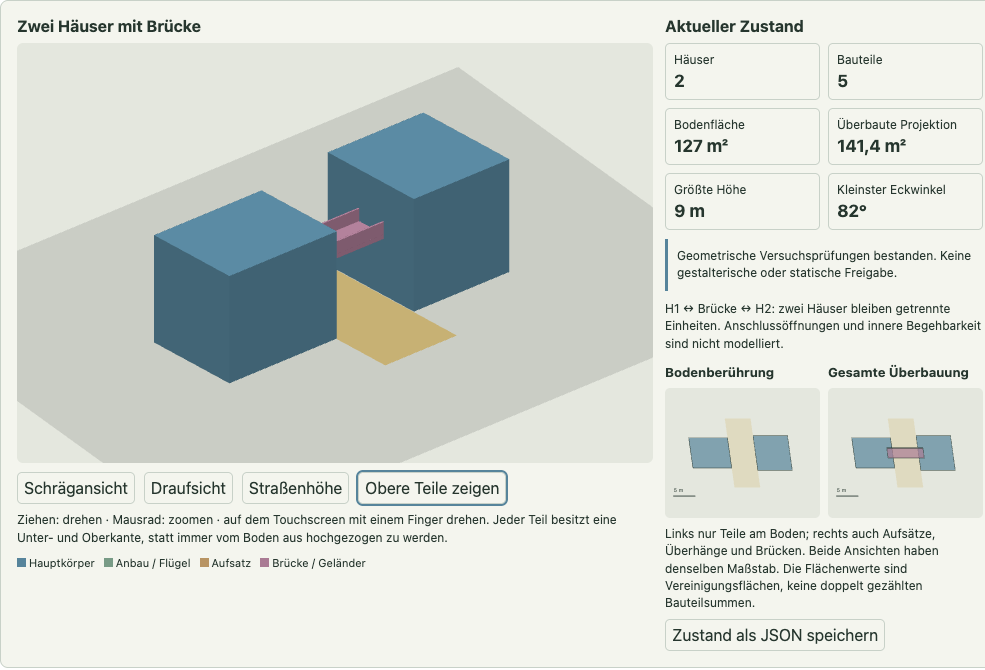

# Haus-Zoo: eigenständiger Gebäude-Generator-Prototyp

Neues Ziel von PR #2: zusammengesetzte, schiefwinklige und höhengestaffelte Häuser unabhängig von der Stadtgenerierung untersuchen. Diese erste Lieferung ist ein **Volumen- und Regelversuch mit fünf festen Beispielrezepten und Varianten**, kein fertiger allgemeiner Hausgenerator und keine gestalterische Freigabe.

Die bisherigen V1-/V2-Bereinigungen bleiben als getrennte Vergleichsbasis verfügbar. Der Zoo importiert weder Stadtgeometrie noch deren Bereinigungsregeln. Die Stadtansicht, Rust-Modelle, Marktplanung und Originalreferenzen werden durch den Zoo nicht verändert.

## Öffnen und bedienen

Voraussetzung: ein aktueller Browser mit WebGL für die räumliche Ansicht. Kein Server, Paketdownload oder GitHub Runner erforderlich.

1. [Eigenständige HTML-Datei](../crates/city_core/prototypes/house-zoo.html) herunterladen und öffnen. Im Checkout unter macOS: `open crates/city_core/prototypes/house-zoo.html`.
2. Ein Beispiel wählen; Seed und Winkelabweichung ändern. Anbauten, Überhang und Brückenparameter erscheinen nur beim passenden Beispiel. Die Auswahl eines anderen Beispiels behält Seed und Winkel bei; „Beispiel zurücksetzen“ stellt dessen feste Ausgangswerte wieder her.
3. Die Ansicht durch Ziehen drehen, mit dem Mausrad zoomen oder Schräg-, Drauf- und Straßenansicht wählen. „Obere Teile zeigen“ ist nur ein Ansichtsfilter und verändert das Modell nicht.
4. Bodenberührung und gesamte Überbauung vergleichen. Eine Brücke oder ein Überhang darf oben Fläche belegen, ohne unten alles zu schließen.
5. Die geführten Versuche einschließlich absichtlicher Gegenproben durchspielen. Rote Meldungen bei Eckkontakt, Überschneidung, schwebendem Aufbau und blockiertem Durchgang sind erwartete Ergebnisse.
6. Den Zustand bei Bedarf explizit als JSON speichern. Ohne diesen Export gibt es keine dauerhafte Speicherung.

Alle Maße sind Meter. Die Beispiele sind keine historisch kalibrierten Gebäudetypen; ihre flachen Abschlüsse sind noch keine ausgearbeiteten Dächer.

## Featurekatalog und Reihenfolge

Abgehakt bedeutet **im Prototyp erprobbar**, nicht gestalterisch akzeptiert. Die offenen Punkte sind weitere Arbeitspakete, keine bereits implementierten Funktionen und nicht alle Teil dieser ersten Lieferung.

### 1. Grundformen und Zusammensetzung

- [x] Kontrolliert schiefwinklige Vierecke statt perfekter Rechtecke: gemeinsame Scherung, einstellbar zwischen 3° und 15° Winkelabweichung. Keine unabhängige Zufallsverschiebung jedes Eckpunkts.
- [x] Hauptkörper mit bis zu sechs kleineren, unterschiedlich hohen Anbauten; ein kleiner Vorbau darf weniger als 2 m tief sein.
- [x] Drei zusammenhängende Flügel mit offenem Hof als Gegenbeispiel gegen pauschale Konvexität oder Rechteckigmachen.
- [ ] Weitere schiefwinklige Formen, unabhängige Hausorientierungen und alternative Anbaurezepte.
- [ ] Gemeinsame gestalterische Sichtung der Formen, Größen und Proportionen.

### 2. Höhen und Aufsätze

- [x] Unter- und Oberkante je Bauteil statt einer einheitlichen Extrusionshöhe je Haus.
- [x] Niedrige Anbauten, höhere Hauptkörper und gestaffelte Aufsätze.
- [x] Zurückspringende Ränder und überhängende obere Flächen.
- [x] Geometrische Auflager-Gegenprobe für einen freischwebenden Aufbau.
- [ ] Typabhängige Geschosshöhen, Materialien und begründete Auskragungsgrenzen. Die aktuelle Halbflächen-Auflagerregel ist nur eine Versuchsvorgabe, kein statischer Nachweis.

### 3. Verbindungen

- [x] Anbauten über gemeinsame Wandabschnitte; bloße Eckberührung genügt nicht.
- [x] Bewusste erhöhte Verbindung zwischen zwei getrennten Häusern.
- [x] Geschlossene Brücke sowie offener Übergang mit Deck und Geländern.
- [x] Durchgang unter der Brücke bleibt frei; eine auf den Boden gesetzte Brücke wird als blockierend gemeldet.
- [ ] Türen, Anschlusshöhen konkreter Geschosse, innere Begehbarkeit, Auflagerdetails und Stützenplanung. Der Versuch belegt nur geometrische Kontakte der Volumen.

### 4. Dächer und weitere Aufbauten

- [ ] Sattel-, Pult- und Walmdächer, passende Übergänge an versetzten Flügeln.
- [ ] Gauben, Erker, Dachaufsätze und überhängende Dachkanten mit eigenen Regeln.
- [ ] Sichtung anhand geeigneter architektonischer Referenzen statt ungeprüfter historischer Behauptungen.

### 5. Zoo und Diagnose

- [x] Fünf feste, voneinander getrennt wählbare Beispiele: kleines Haus, viele Anbauten, Flügel/Hof, Aufsätze/Überhang und zwei Häuser mit Brücke.
- [x] Seedabhängige Maße beziehungsweise Höhen; wiederholbare Einstellungen ohne Stadtgenerator.
- [x] Drehbare WebGL-Ansicht, Draufsicht, Straßenansicht, sichtbare Bauteile und vollständiger Modellstatus.
- [x] Bodenfläche und gesamte projizierte Überbauung getrennt; Überlappungen werden in den Flächenwerten nicht doppelt gezählt.
- [x] Absichtlich ungültige Gegenproben werden angezeigt statt automatisch repariert.
- [ ] Gestalterische Annahmen und Ablehnungen pro Variante festhalten; die Geometrieprüfung ersetzt diese Entscheidung nicht.

### 6. Spätere Stadt- und Nutzungsanbindung

- [ ] Bauplätze, vorhandene Straßen und Freiräume als Eingaben eines späteren Adapters.
- [ ] Überhänge und Brücken anhand ihrer Höhe prüfen, nicht als flächige Vereinigung von Grundstücken behandeln.
- [ ] Haushalte, Betriebe und Institutionen von Gebäuden getrennt halten; passende Gebäuderezepte und Nachfragegewichte begründen. Siehe [Gestaltungsrahmen](social-settlement-design.md) und [Marktplanung V1](market-planning-v1.md).
- [ ] Erst nach Sichtung freigegebene Regeln in die native Stadtanwendung übernehmen. Keine pauschale Typzuweisung nur aus einem Distriktnamen oder der Marktfarbe.

## Modell und Prüfungen dieses Versuchs

Die reine Logik liegt im HTML-Block `house-logic` und kennt weder DOM noch WebGL oder Stadtcode. `generate(parameters)` liefert Häuser, Bauteile und Verbindungen; `inspect(scene)` beschreibt die geometrischen Befunde. Die HTML-Oberfläche und der Renderer sind ein Wegwerfrahmen um dieselbe Logik.

- Ein Haus behält seine Identität trotz mehrerer Teile. Eine Brücke ist eine ausdrückliche Verbindung zwischen zwei Häusern, keine automatische Zusammenführung.
- Jeder Teil besitzt einen Grundriss sowie Unter-/Oberkante. Die gemeinsamen schiefwinkligen Grundrisse entstehen aus lokalen Rechtecken durch eine flächentreue Scherung.
- Die aktuelle Flächen- und Kollisionsprüfung arbeitet deshalb exakt auf diesen lokalen Rechtecken und Höhenintervallen. Sie ist **kein allgemeiner Prüfer beliebiger 3D-Körper oder gedrehter Polygonmengen**.
- Anbauten müssen einen Wandabschnitt mit ihrem Elternteil teilen. Unbeabsichtigte räumliche Überschneidungen werden gemeldet. Deklarierte Brückenanschlüsse dürfen in die Hausvolumen hineinreichen; tatsächliche Öffnungen werden noch nicht ausgeschnitten.
- Aufsätze benötigen im Versuch mindestens die Hälfte ihrer Projektion als Auflager an der passenden Höhe. Ein von unten gestützter Elternteil wird dadurch nicht statisch nachgewiesen.
- Im Brückenbeispiel ist ein Durchgang bis 3 m Höhe freizuhalten. Dieser Wert ist eine Demonstrationsvorgabe, keine allgemeine Durchfahrtsnorm.
- Der erste Beispielkatalog verwendet eine gemeinsame Schiefstellung pro Szene, feste Anschlussrezepte und begrenzte Parameter. Er sucht noch keine beliebigen Baukörperkombinationen.

Die frühere pauschale 2-m-Kantenregel ist bewusst nicht Teil des Zoos: Ein Vorbau oder Geländer ist kein kleiner Wohnkörper. Weitere Nutzbarkeits- und Typregeln müssen anhand der Beispiele festgelegt werden.

## Lokale Ergebnisspur

```sh
# Reproduzierbare Modellzustände aus exakt derselben HTML-Logik ausgeben:
node crates/city_core/prototypes/run-house-zoo.mjs
```

[Aufgezeichnete Ausgangs- und Gegenproben](../crates/city_core/prototypes/house-zoo-runs.json) enthalten die vollständigen Zustände samt HTML-/Logik-Prüfsummen. [Lokaler Prüfnachweis](house-zoo-proof.json) und die folgenden Aufnahmen halten die technische Sichtung fest. Sie sind keine Architekturfreigabe. Es werden keine GitHub Actions oder Runner eingerichtet oder ausgelöst.






