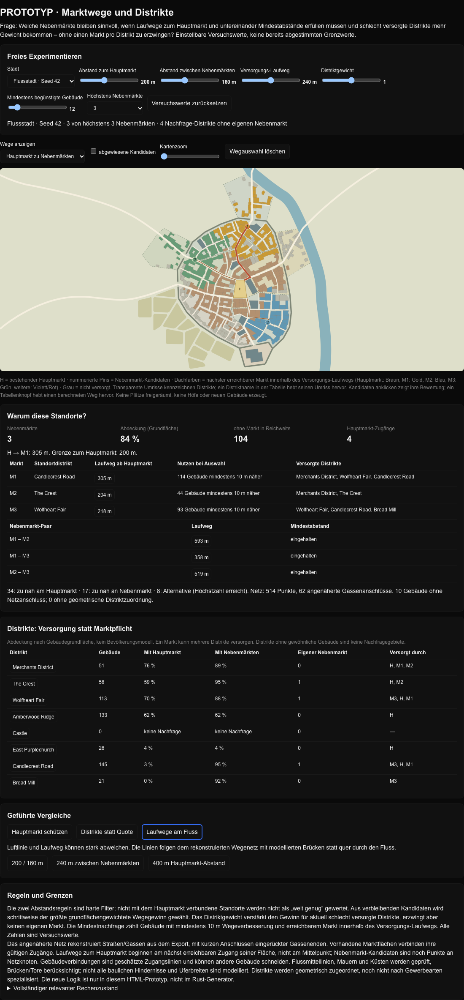

# Runde 2: Marktwege und Distrikte

Frage: Welche Nebenmarkt-Standorte bleiben sinnvoll, wenn Hauptmarkt-Abstand, gegenseitiger Abstand und Distriktversorgung gemeinsam berücksichtigt werden, ohne jedem Distrikt einen eigenen Markt zuzuteilen?

**Nachfolgestand:** Das Regelwerk wurde als Basis akzeptiert und als [Marktplanung V1](market-planning-v1.md) in Rust übernommen. Diese Seite und das HTML dokumentieren die eingefrorene Prototypreferenz; Hof- und Wachstumsregeln sind davon nicht abgenommen.

## Öffnen und reproduzieren

[`market-district-lab.html`](../crates/city_core/prototypes/market-district-lab.html) herunterladen und per Doppelklick öffnen. Keine Installation und kein Server nötig. Die Datei enthält die drei realen Ausgangsstädte aus Runde 1, ergänzt um ursprüngliche Distriktpolygone, Marktflächen, Brücken und Tor-/Mauerangaben. Zum Zeitpunkt dieser Runde war der Rust-Planer noch unverändert; der spätere V1-Port wird gegen diese Referenz geprüft.

Die Ansicht bietet einstellbare Abstände, Versorgungsweg, Distriktgewicht, Mindestnachfrage und Höchstzahl; geführte Vergleiche, anklickbare Laufwege, Ablehnungsgründe und eine Distrikt-Versorgungstabelle. Distriktnamen markieren den Umriss auf der Karte. Die Dachfarben zeigen hier **Einzugsgebiete von Märkten, keine Gebäudenutzungen**.

```sh
node crates/city_core/prototypes/run-market-district-lab.mjs
```

[`market-district-runs.json`](../crates/city_core/prototypes/market-district-runs.json) enthält die 27 ausgeführten Konfigurationen, gewählte Standorte, Entfernungen, Distriktabdeckung, Regelverletzungszähler und HTML-Prüfsumme. Der zweite Lauf reproduzierte diese JSON-Datei bytegleich. Drei Ansichten einschließlich Wegknopf, Eingaberegler, Distriktauswahl und Null-Markt-Fall sowie ein Karten-Kandidatenklick wurden ausgeführt; keine Konsolenfehler. Keine formalen Tests für diesen Wegwerfprototyp ergänzt.



## Verwendete Regeln

1. Ein angenähertes Wegenetz rekonstruiert Straßenkurse und Gassen mit tatsächlichen Schnittpunkten und kurzen Anschlüssen eingerückter Gassenenden. Vorhandene Marktflächen verbinden gültige Zugänge. Brücken und Tore erlauben ansonsten gesperrte Querungen.
2. Laufwege zum Hauptmarkt beginnen am nächst erreichbaren Zugang seiner Fläche, nicht am Mittelpunkt. Nebenmärkte sind in dieser Runde Kandidatenpunkte an Kreuzungen; ihre späteren Platzflächen sind noch unbekannt.
3. Hauptmarkt-Abstand und Nebenmarkt-Abstand sind getrennte harte Filter. Ein nicht mit dem Hauptmarkt verbundener Kandidat gilt nicht einfach als weit genug, sondern wird abgelehnt.
4. Aus zulässigen Kandidaten wird schrittweise der größte nach Gebäudegrundfläche gewichtete Wegegewinn ausgewählt. Die Bewertung deckelt Entfernungen beim einstellbaren Versorgungsweg.
5. Für einen Distrikt wird der aktuell nicht versorgte Anteil seiner Gebäudegrundfläche berechnet. Gewinne seiner Gebäude erhalten den Faktor `1 + Distriktgewicht × unversorgter Anteil`. Das ist eine weiche Priorisierung, keine Marktquote. Die räumliche Zuordnung erfolgt anhand der ursprünglichen Distriktpolygone; Gewerbecharakter wird noch nicht modelliert.
6. Zusätzlich muss eine einstellbare Anzahl von Gebäuden mindestens 10 m näher an einem Markt liegen und ihn innerhalb des Versorgungswegs erreichen. Die Höchstzahl ist nur eine Obergrenze; null Standorte sind erlaubt.

Alle Schwellen sind **Entwurfsparameter, keine abgestimmten oder historischen Werte**. Ausgangsregler: Hauptmarkt 200 m, Nebenmärkte untereinander 160 m, Versorgung 240 m, Distriktgewicht 1, mindestens zwölf begünstigte Gebäude, höchstens drei Standorte.

## Beobachtungen aus 27 Läufen

Je Stadt wurden neun Konfigurationen ausgeführt: nur Hauptmarkt, 100/100 m, 200/160 m mit Distriktgewicht 0/1/2, 300/240 m, 400/320 m, hohe Mindestnachfrage und kurzer Versorgungsweg. Keine ausgewählten Standorte verletzten die eingestellten Haupt- oder Nebenmarkt-Abstände **innerhalb des rekonstruierten Netzes**; keiner war vom Hauptmarkt unerreichbar.

| Stadt | Standorte bei 200/160 m | Grundflächenabdeckung | Standorte bei 300/240 m | Grundflächenabdeckung |
| --- | ---: | ---: | ---: | ---: |
| Landstadt, Seed 42 | 3 | 70 % | 0 | 54 % |
| Flussstadt, Seed 42 | 3 | 84 % | 2 | 73 % |
| Cloudhill, Seed 12345 | 3 | 70 % | 3 | 65 % |

Versorgungsweg jeweils 240 m, Distriktgewicht 1 und Mindestnachfrage zwölf Gebäude. Abdeckung bezieht sich auf gewöhnliche Gebäudegrundfläche, nicht auf Einwohner. Größere Abstände verbessern das Stadtbild nicht automatisch: Sie können die Versorgung verschlechtern oder alle Standorte ausschließen.

- In der Flussstadt verändert Distriktgewicht 1 gegenüber 0 die gewählten Standorte; die Abdeckung beträgt im Versuch 84 statt 81 %. Das belegt einen Effekt der Gewichtung in diesem Fall, keine allgemeine Überlegenheit.
- Bei 200/160 m bleiben 2/4/3 Nachfrage-Distrikte ohne eigenen Nebenmarkt. Manche werden von einem Markt eines anderen Distrikts mitversorgt; andere bleiben schlecht versorgt. Keine automatische Marktpflicht.
- Hohe Mindestnachfrage von 80 begünstigten Gebäuden ergibt 0/3/2 Standorte. Bedarf kann die Anzahl also zusätzlich zum Abstand reduzieren.

## Noch nicht entschieden oder gelöst

- Das Regelwerk ist als V1-Basis akzeptiert. Abstände, Versorgungswege und Gewichtungen bleiben veränderbare Profileinstellungen; reale Marktflächen sind damit nicht baulich freigegeben.
- Die Abstandsregeln gelten für den angenäherten Graphen. Gebäudezugänge sind geschätzt und können andere Gebäude schneiden; vollständige Uferbreiten und bauliche Hindernisse fehlen. Auf vier Nachkommastellen gerundete Exportgeometrie ist keine Referenz für Originaltreue.
- Die neue Logik berechnet Standorte selbst neu, ist aber noch nicht mit Platzgröße, Abrisskosten, Kapazität oder wirtschaftlicher Entwicklung gekoppelt. Sie räumt keine Plätze frei.
- Distrikte haben noch keinen Gewerbe-/Nutzungscharakter. Die Gewichtung nutzt nur geometrische Zugehörigkeit und Versorgungsdefizit.
- Hofumbauten und Vorstadtregeln aus Runde 1 wurden nicht weiterentwickelt und bleiben unbefriedigend; nur die akzeptierte Marktlogik wird in Rust/Bevy übernommen.

Der übergreifende Stand und die offenen Versuche bleiben in [organic-city-experiments.md](organic-city-experiments.md).
